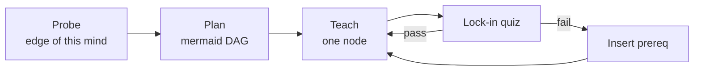

# Alvar Method Process — Probe → Plan → Teach → Close

Back to [Alvar Method Index](/alvar-method/index.md) | [Brain Index](/index.md). Related: [Philosophy](/alvar-method/philosophy.md), [Teaching Protocols](/alvar-method/teaching-protocols.md), [Visual & Verify](/alvar-method/visual-verify.md).

> Source: Eero Alvar, *How I Use AI to Learn Things* (2026-08-14). The process is the implementation of the two principles. See [transcript.md](/alvar-method/transcript.md) for the original description.

## Overview

```
Phase 0 (Review) → Phase 1 (Probe) → Phase 2 (Plan) → Phase 3 (Teach) → Close
```



## Phase 0 — Review (Session Start)

Runs before the probe. The end of a session is what gets dropped when it runs long, and this is the cheapest warm-up available.

- Read the spaced-review queue. Find rows whose `next_review` is today or earlier.
- Include any open misconception whose topic touches today's material.
- Nothing due: say nothing and go to Phase 1. Never announce zero items.
- Anything due: say how many and which topics, then offer to run now, pick a subset, or skip today.
- A skip is a first-class answer. Log it and move those rows to tomorrow.
- Quiz a due item by free recall first, multiple choice second. A miss re-teaches it this session.

## Phase 1 — Probe

**Goal:** Map the learner's exact current understanding before teaching anything.

### How it works
1. Identify the dependency strands the goal rests on.
2. For each strand, binary-search the edge with graded multiple-choice questions.
3. Start broad. A correct answer moves that strand harder; a miss or a gap moves it more basic.
4. Ask 1–3 questions per turn. Wait for the tool result. Do not dump a long exam.
5. Let the learner talk through reasoning in a note or chat. Treat that as signal — a wrong reason + right letter is `edge`, not `known`.
6. Never reveal the answer inside the question. Never teach during the probe.
7. After each batch, tell the learner what was right, wrong, or a gap, in one line each. Explanations wait for the lesson.
8. Stop a strand when the edge is bracketed. Stop probing when every strand has an edge.

### Strand labels

| Status | Meaning |
|--------|---------|
| `known` | Correct answer + sound reasoning |
| `edge` | Correct answer with thin reason, or near-miss wrong answer |
| `unknown` | Wrong answer, foundation missing |
| `blocked` | "I don't know" or needs a tool the system doesn't have |

### Quiz mechanics
- Use the harness quiz UI (native picker), never A/B/C/D pasted in chat. See [Skills Reference](/alvar-method/skills-reference.md) for the tool mapping per agent.
- 3 content options + "I don't know" as a labeled last option (never shuffled with content).
- Other/free-text is for thought process, not a scored pick.
- Unicode math in quiz text (|ψ⟩, √2, ², ⊗), never LaTeX. When real notation is needed, write the LaTeX to the session log first and point the quiz at the live view.

### Scoring

| Result | Status Move |
|--------|-------------|
| correct + sound reason | `known` |
| correct, thin reason | `edge` |
| wrong, near-miss | `edge` |
| wrong, foundation missing | `unknown` |
| I don't know | `blocked` or `unknown` |

### Output
Write the probe map to the session file: each strand, the edge found, misses and gaps.

> "A long probe is a feature when context is thin. It is also a warm-up."

## Phase 2 — Plan

**Goal:** Reason out the full teaching path from the measured edges to the goal. Do not wing it.

### How it works
1. Build a dependency DAG. Each node is one reasoning step, not a chapter.
2. Start from `known`. Path through `edge`. Do not start in `unknown` with no ramp.
3. Launch a fact-check subagent on the claims the lesson will rest on. Both modes. Never skip.
4. Show the plan as a mermaid graph **before** teaching.
5. Ask if the learner wants the graph changed. Then freeze it until a quiz failure forces a new node.

### Why the graph is mandatory
Two reasons from the video:
1. The learner gets a better sense of what's to come.
2. **The real reason:** it forces the AI to reason everything out. It cannot cheat and wing it.

> "The actual reason I implemented it is to actually force the AI to reason everything out. That's the real reason. It cannot just cheat and wing it."

### Fact-checking
- Empirical, historical, bibliographic, or API/tool claims → verify against sources.
- Named theorems, identities, or "standard facts" you cannot reconstruct → verify.
- Skip only when you can derive the statement in-session and the learner does not need an external citation.
- A verdict without a source URL counts as unverified. Anything unconfirmed gets taught as contested or dropped.
- The fact-check itself never appears in the session log — it runs, and the plan corrects itself when a claim fails.

### Output
Append the plan to the session log as a mermaid DAG (`graph TD`), nodes = concepts, edges = depends-on, with the current-edge nodes marked. Show the arc and confirm before teaching.

## Phase 3 — Teach

**Goal:** Walk the DAG. One node per turn. One reasoning step per message.

### How it works
1. One reasoning step. Stop. Do not rush the whole graph.
2. The idea, why it must be true or how it falls out of the previous step, one concrete worked example.
3. Open conceptual steps with a prediction before explaining anything. A wrong prediction is the point — it is never graded.
4. If a picture would lock the idea, use `learn-visual` (or write an SVG and look at it).
5. Open the notes gate ("yap note") before any quiz: let the learner type their thinking, questions, or context.
6. After the step, quiz that step. Three reasons:
   - The learner cannot gaslight themselves into thinking they understood.
   - The system needs continuous feedback to stay calibrated.
   - Applying the material is part of how new understanding locks in.
7. Advance only on lock-in. A miss → stay, re-teach from a different angle, re-quiz.
8. Accept questions mid-step. Do not "just finish the slide." Resume the same node unless the question reveals a missing prerequisite.

### The ChatGPT failure mode
> "What usually happens if you're talking to ChatGPT or something trying to get it to explain or teach you anything, it usually just — it's way too excited and it rushes through the whole thing."

One reasoning step per turn prevents this. Each step is easy to digest. The learner can ask questions at any point.

### What the system absorbs vs what the learner handles

| System absorbs | Learner handles |
|---|---|
| Order of topics | Thinking about the material |
| Finding sources | Answering quizzes |
| Verifying facts | Writing notes / reasoning |
| "What next" | Asking questions |
| File logging | |
| Diagrams | |

## Close — Session End

1. Write **Key takeaways** to the log: load-bearing facts, cuts, and traps from the whole session, compressed to a numbered list.
2. Under it, a **What to focus on** subsection: curated from the learner's path — their misses, sure-and-wrong items, habits that cost them.
3. Close the log: where in the DAG the session stopped, the count line ("11 of 14 confirmed, 3 open") naming the open items, and what to resume with.
4. Report the calibration line: how often the learner answered *sure* and was wrong.
5. Write active time: active minutes only, computed from timestamps on the learner's messages. Gaps over 10 minutes with no input move the timer back 10 minutes (floor 0).
6. Set next review dates in one batched quiz over newly confirmed items, proposing the spaced-review ladder.
7. Write review rows to the review queue.
8. Update the learner profile: new edges, quiz outcomes, style preferences. Dated entries, supersede rather than rewrite.
9. Tell the learner the log path.
