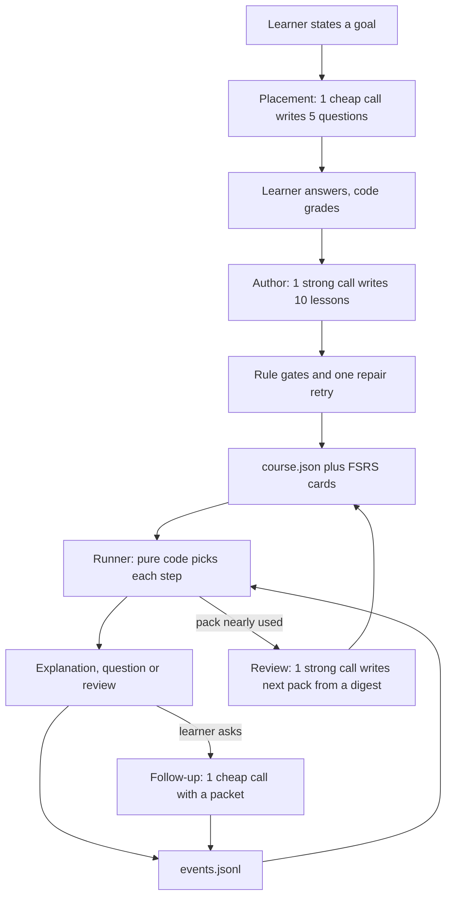

# Architecture

Back to [Cheap Tutor Plan](/cheap-tutor/index.md). Related: [ADR-0007](/decisions/0007-course-as-data.md), [Memory System](/cheap-tutor/memory-system.md), [Lesson Packs](/cheap-tutor/lesson-packs.md), [Model Routing](/cheap-tutor/model-routing.md).

## 1. The idea in one sentence

**A course is data, not a conversation.** A strong model writes an hour of lessons in one call, code runs the hour, and a cheap model answers only when the learner actually asks something.

## 2. Today against this design

| | Today | This design |
|---|---|---|
| What asks the next question | A model call | Code reading stored lessons |
| What grades a multiple-choice answer | Code, then a model call to continue | Code, no model call |
| What grades a typed answer | A model call | Code first, the learner confirms; a cheap call only on request |
| What a model sees | Prompt + whole transcript | A fixed-size context packet |
| What happens when every AI is limited | The session stops | Study continues from stored lessons and due reviews |
| Strong model use | Whatever the role is pinned to, per step | About once an hour of study |

## 3. Flow

## 4. Crate boundaries

These follow the rules in `CLAUDE.md`: pure logic in `lp-core`, files in `lp-store`, models in `lp-agent`, app logic in `lp-service`, HTTP in `lp-server`, and no domain logic in TypeScript.

| Crate | New or changed | Contents |
|---|---|---|
| `lp-core` | new `course` module | `Course`, `Lesson`, `Item`, `CourseEvent`; `gate_item`; `next_step`; `fold_learner`; `render_packet`; `match_answer`. Pure, no IO, with property tests. |
| `lp-store` | new `courses` store | `courses/<id>/course.json` (atomic JSON) and `events.jsonl` (append-only), per workspace via `Stores::open(root)`. Items also become tracker cards. |
| `lp-cli-driver` | small change | Optional `system` on `TurnRequest`, passed as Claude's `--system-prompt`. Fix for the Kiro hang. |
| `lp-agent` | new `course` module | `author`, `place`, `review` and `follow_up` prompts. No tool protocol: JSON out, parsed and gated. |
| `lp-service` | new `course` module | Creating courses, answering, refills in the background, usage budget, role routing. |
| `lp-server` | new routes, DTOs | `/courses` endpoints and SSE, OpenAPI generated from the DTOs. |
| `web/` | new Course screen | Reuses the existing quiz dock, confidence control and markdown rendering. |

## 5. What stays as it is

- **Existing Teach chats keep working.** `run_turn` is not removed in this plan. New topics default to courses once they pass acceptance.
- **Practice, workbench jobs, ingest, digest and the graph are untouched**, apart from the graph fold in [Memory System](/cheap-tutor/memory-system.md).
- **Review** gains course cards through the existing tracker tables, with no new screen.

## 6. Deliberately skipped

Ponytail list. Each has a condition for revisiting it.

| Skipped | Why | Revisit when |
|---|---|---|
| Streaming partial lessons from the author call | Adds a partial JSON parser to save a 96-second wait | Learners abandon during the wait |
| Elo or BKT learner models | FSRS and per-lesson accuracy already exist or are trivial | Sequencing visibly misjudges a learner |
| Embeddings or vector retrieval | The packet is small and every field is known | Follow-ups need facts outside the packet |
| Per-step cheap writer | State on Haiku costs about 10x one shot, and needs a call per step | Stored lessons feel too rigid in the real-hour test |
| A cascade that verifies items with a second model | No evidence yet that it catches errors. It would double output. | Learners report wrong items often |
| Replacing `run_turn` | No need to risk what works | Courses pass acceptance, and nobody opens old chats |
| Roleplay conversation mode | Valuable, but a separate feature | Courses ship. First follow-up task for language topics. |
