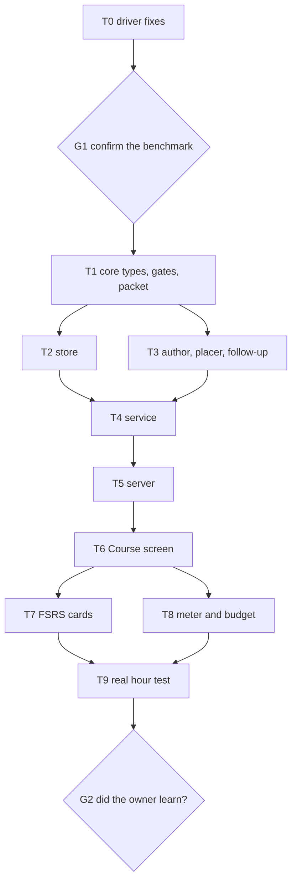

# Task DAG

Back to [Cheap Tutor Plan](/cheap-tutor/index.md). Related: [Architecture](/cheap-tutor/architecture.md), [Model Routing](/cheap-tutor/model-routing.md), [Global Task DAG](/tasks/index.md).

Branch flow as in `CLAUDE.md`: `prod <- staging <- pratham404/<task-id>`. `make gate` before each merge. Nothing merges to `prod` without the owner's say.

## T0: driver fixes

**Do first, because it helps today's app with no redesign.**

- `system: Option<String>` on `TurnRequest`, used by Claude and Codex.
- Reproduce and fix the Kiro hang through the driver.
- Correct the "already tried your other AIs" message.
- Show second-based chat timestamps properly: `created_at` values such as `1793131171` display as "691 months ago". Migrated artifact paths also still point to the old location. Both were found during the prod release.

**Files:** `crates/lp-cli-driver/src/engine/{mod,subprocess}.rs`, `crates/lp-service/src/engine.rs`.
**Tests:** subprocess tests assert the new flags. A Kiro fixture covers the hang.
**Accept:** `bench_call` reports about 650 input for a Claude "ok" and answers on Kiro within 30 seconds.

## G1: confirm the benchmark

**A decision gate. Costs about 6 Opus calls.**

The one-shot result rests on a single 10-lesson Opus run on Spanish. Before building on it:

- Run Opus 10-lesson on Rust and on one new, non-language topic, each twice.
- Add the new schema fields, and measure the output increase.
- Test 20 lessons in one call, to see if it decays.

**Continue if:** every run parses, late lessons stay within 1 point of early ones, and output stays under about 15,000 for 10 lessons. **If not:** switch the default to Cheap skeleton + Haiku, which needs no strong model and is already measured.

## T1: core types, gates, packet

**Files:** new `crates/lp-core/src/course.rs`.
**Contents:** `Course`, `Lesson`, `Item`, `CourseEvent`, `gate_item`, `gate_course`, `match_answer`, `fold_learner`, `next_step`, `render_packet`, all pure.
**Tests:** proptest: replay is deterministic, any event prefix is valid, the packet never exceeds its cap, `next_step` never shows a flagged item and never repeats within 3 steps. Unit tests from real benchmark output in `bench/cheap_tutor/results/`.
**Accept:** `make gate`, and `lp-core` stays free of IO and async.

## T2: store

**Files:** new `crates/lp-store/src/courses.rs`.
**Contents:** atomic `course.json`, append-only `events.jsonl`, using existing helpers, per workspace root.
**Tests:** torn tail recovery, concurrent appends, two workspaces stay isolated.
**Accept:** `make gate`.

## T3: author, placer, follow-up

**Files:** new `crates/lp-agent/src/course/` with prompts as markdown, following `loops/prompts`.
**Contents:** JSON-out calls with no tool protocol, gates, a single repair, ladder selection by role.
**Tests:** `FauxEngine` for parsing, repair and fallback. Real-model checks stay in `bench/`, not in `make gate`.
**Accept:** Run against the benchmark's two scenarios, it produces gated courses, and the judge's most common flaw, testing what was not taught, goes down.

## T4: service

**Files:** new `crates/lp-service/src/course/`.
**Contents:** create course, answer, next, follow-up, background refill, budget. Blocking work in `spawn_blocking`.
**Tests:** a full simulated hour with `FauxEngine`, asserting the number of model calls. Limits on every provider: the session continues.
**Accept:** A simulated 60-step hour with no learner questions makes at most 3 model calls.

## T5: server

**Files:** `crates/lp-server/src/routes/courses.rs`, DTOs, `docs/web/03-server-api.md`.
**Contents:** `/w/{ws}/courses` routes and SSE for refill status. `web/openapi` regenerated.
**Tests:** route tests. No `unwrap()`, no tokens in responses.
**Accept:** `make gate`, `make api-check`.

## T6: Course screen

**Files:** `web/src/features/course/`, reusing classroom components.
**Contents:** course list, placement, the wait at 1:30 filled with real content, explanation card, question dock, feedback, self-grade, "this looks wrong", ask-a-question, session summary.
**Tests:** MSW typed by `components["schemas"]`, with no response-rewriting shims, per the status memory. `make e2e`.
**Accept:** A learner finishes a lesson with the network mocked to refuse all model calls, because stored steps need none.

## T7: FSRS cards

**Files:** `crates/lp-service/src/course/`, `crates/lp-service/src/review.rs`.
**Contents:** gated items become cards. Answers map to ratings. Due reviews open a returning session.
**Tests:** A review done in a course shows in Review, and the reverse.
**Accept:** After a course session, `/review` lists its items when due.

## T8: meter and budget

**Files:** `crates/lp-service/src/course/`, the session header.
**Contents:** usage events, tokens by tier, the strong-call cap. Also adds `make bench`, which is not part of `make gate` because it spends quota.
**Tests:** A third strong call in an hour queues.
**Accept:** The meter's totals match what the CLIs report, within rounding.

## T9: real hour test

The acceptance in [Hour-Long Session](/cheap-tutor/hour-session.md). Also checks: whether self-grading is honest enough, whether 60 items last an hour, whether key facts are good graph propositions, and how the real quota limit responds.

## G2: did the owner learn?

Pass: new topics default to courses, and `prod` gets a release. Fail: read what failed before writing any more code. If learning fails while the cost is fine, the design's weak point is content or sequencing, and it can be changed cheaply. If usage fails, the [Benchmark](/cheap-tutor/benchmark.md) was wrong, and rerunning it on real session logs comes first.

## Estimated order of value

If time runs short, T0 alone improves today's app. T1 through T6 deliver the hour. T7 delivers learning across days. T8 is what keeps it honest.
