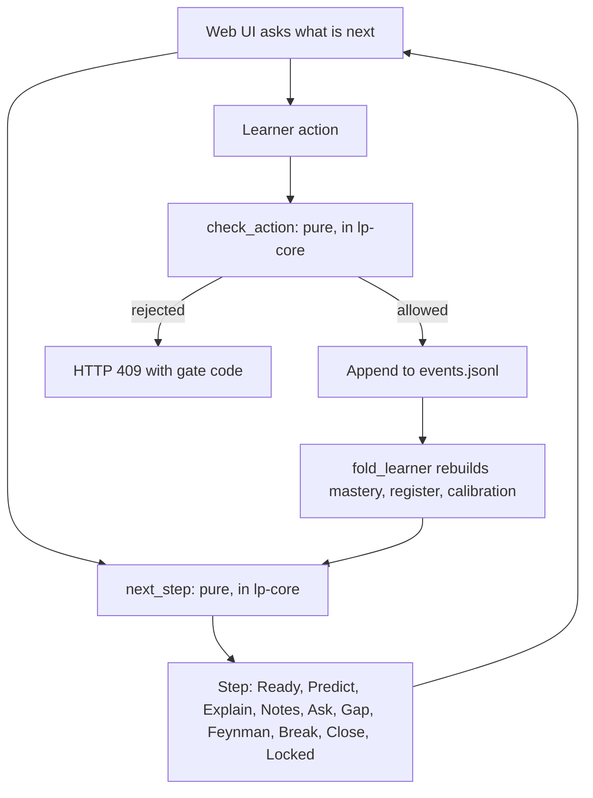

# Learning Method Architecture and Folders

Back to [Learning Method Plan](/learning-method/index.md). Related: [Features](/learning-method/features.md), [Task DAG](/learning-method/task-dag.md), [Core Domain](/architecture/core-domain.md).

Paths are relative to `staging` plus the T6 work, since the course code is not on `prod`. Boundaries follow `CLAUDE.md`: pure logic in `lp-core`, files in `lp-store`, models in `lp-agent`, app logic in `lp-service`, HTTP in `lp-server`, and no method logic in TypeScript.

## 1. Enforcement flow



Two pure functions carry all enforcement. `next_step` says what comes next. `check_action` rejects anything out of order, such as answering an item not issued, finishing a lesson with facts below `mc-passed` (parked facts excepted, see F14), or starting teaching on an unconfirmed plan. Both take `now: i64` and a seeded RNG handle as plain arguments — `lp-core` never reads the system clock or calls `rand::thread_rng()` itself, so `bout.rs` and `pacing.rs` stay pure and replay deterministically. Because they are pure, both can be property-tested without a server or a browser.

## 2. Course schema additions

All fields use `#[serde(default)]`, so courses already on disk still load. They run with no predictions or stored angles, and a miss falls through to a cheap re-teach call.

```rust
pub struct Course {
    // existing fields, plus:
    pub method_version: u32,
    pub why: String,
    pub strands: Vec<Strand>,        // probe result
    pub plan_confirmed_at: Option<i64>,
}

pub struct Lesson {
    // existing fields, plus:
    pub depends_on: Vec<String>,     // lesson ids; forms the DAG
    pub kind: LessonKind,            // Conceptual, Procedural, Definitional
    pub hook: String,                // why this matters, one line
    pub aside: Option<String>,       // related but not central
    pub predict: Option<Prediction>, // ungraded, never scored
    pub angles: Vec<String>,         // alternate explanations for re-teach
    pub rungs: Vec<Rung>,            // full, blanked, solo; procedures only
    pub claims: Vec<Claim>,          // falsifiable statements to fact-check
}

pub struct Item {
    // existing fields, plus:
    pub level: u8,                   // 1 to 3, for difficulty control
    pub must_name: Vec<String>,      // recall rubric checked by code
    pub misconceptions: Vec<String>, // per option: belief implied by choosing it
}
```

`Item.tests` already links an item to a key fact, so the mastery bar needs no new link.

## 3. New events

Everything derives from the event log, as the cheap tutor's memory rules require.

| Event | Written when |
|---|---|
| `PlanConfirmed`, `PlanEdited` | Learner accepts or changes the map |
| `Predicted` | Learner commits to a prediction, ungraded |
| `NoteWritten` | Notes gate is answered |
| `Answered` (extended) | Adds `gap`, `reasoning`, and three-level confidence |
| `RecallGraded` | Exact match, rubric or model grade, with its source |
| `FeynmanGraded` | Grade plus the learner's verbatim wording |
| `ReviewSkipped`, `DateChosen` | Review choices |
| `ItemParked` | Three failed attempts |
| `PrereqInserted` | A lesson is added to a frozen plan |
| `GapShown`, `RewardShown` | Pauses and rewards, so replay stays deterministic |
| `ClaimVerdict` | Fact-check result |

Bouts are stored per workspace, not per course, because the 90 and 270 minute limits apply across courses: `BoutStarted`, `BoutEnded`, `FocusLost`, `Heartbeat`, `Override`.

## 4. On-disk layout

```text
workspaces/<ws>/
├── learning/                 NEW, workspace-wide
│   ├── bouts.jsonl           bout events
│   ├── checkins.jsonl        sleep check-ins
│   ├── register.jsonl        misconception rows, written at grading time
│   ├── profile.jsonl         dated profile entries; latest wins
│   └── schedule.json         slots, wake time, settings
└── courses/<id>/
    ├── course.json           extended schema
    ├── events.jsonl          extended events
    └── sessions/             NEW
        └── <date>-<n>.md     session log, written by code
```

## 5. Folder map

`NEW` adds a file. `EDIT` changes one.

### `crates/lp-core/src/` (pure, no IO, no async)

```text
course.rs             EDIT  schema, events, Step variants, compose next_step
method/               NEW
├── mod.rs                  check_action, GateError, settings struct
├── mastery.rs              per-fact state machine, count line
├── probe.rs                strand binary search and labels
├── dag.rs                  lesson graph checks, load-bearing nodes, mermaid text
├── bout.rs                 active time, 90 / 2h / 270 limits, override rule
├── pacing.rs               seeded gap and reward timing
├── difficulty.rs           rolling error rate, level choice
├── register.rs             misconception fold, recurring status
├── recall.rs               rubric check over must_name
└── close.rs                report and session log rendering
lib.rs                EDIT  export method
```

`course.rs` is already 1,531 lines, so new logic goes in `method/` and `course.rs` only composes it.

### `crates/lp-store/src/`

```text
learning.rs           NEW   bouts, checkins, register, profile, schedule
courses.rs            EDIT  session log append
lib.rs                EDIT  export
tests.rs              EDIT  torn tail, workspace isolation
```

### `crates/lp-agent/src/course/`

```text
mod.rs                EDIT  new roles, batch grading
verify.rs             NEW   claim job, using workbench search and fetch adapters
prompts/author.md     EDIT  new fields and rules
prompts/lesson.md     EDIT  same fields for the fallback path
prompts/outline.md    EDIT  depends_on, kind
prompts/place.md      EDIT  strands at 3 levels
prompts/reteach.md    EDIT  must not state or point at the answer
prompts/grade_batch.md NEW  recall answers against rubric, per lesson
prompts/feynman.md    NEW   does the mechanism survive?
prompts/verify.md     NEW   source and exact quote per claim
prompts/prereq.md     NEW   short lesson for a missing foundation
```

`verify.rs` reuses the fetcher in `workbench/adapters.rs`, which already has internal-address vetting, and needs no new dependency. Everything a model wrote stays fenced as data.

### `crates/lp-service/src/`

```text
course/mod.rs         EDIT  gate every action through check_action; 1,439 lines, so new flows go below
course/plan.rs        NEW   show, edit, confirm, prerequisite insert
course/grading.rs     NEW   recall ladder, batches, pending grades
course/verify_job.rs  NEW   background fact-check, quote check, hide contradicted items
course/close.rs       NEW   close flow, log, review dates, graph writes of confirmed facts
course/tests.rs       EDIT  simulated full bout
learning/             NEW
├── mod.rs                  service struct
├── bout.rs                 start, heartbeat, end, override
├── schedule.rs             slots, kept and missed, .ics text
├── checkin.rs              sleep check-in
└── profile.rs              dated entries, packet input
review.rs             EDIT  recall first, skip, chosen dates, first test within 1 day
paths.rs              EDIT  learning directory
lib.rs                EDIT  export learning
```

### `crates/lp-server/src/`

```text
routes/courses.rs     EDIT  plan, predict, note, feynman, close routes; 409 gate mapping
routes/learning.rs    NEW   bouts, check-ins, schedule, profile, register
routes/mod.rs         EDIT  register
dto/course.rs         EDIT  new Step variants and fields
dto/learning.rs       NEW   DTOs
dto/mod.rs            EDIT  register
app.rs                EDIT  state
openapi.rs            EDIT  schemas
```

`docs/web/03-server-api.md` and `docs/web/06-screens.md` get edited in the same tasks, since they are the spec. `web/openapi/` is regenerated.

### `web/src/`

```text
features/course/                 from T6
├── Lesson.tsx               EDIT render the server's Step only
├── Placement.tsx            EDIT strand probe, one-line verdicts
├── steps/                   NEW
│   ├── PredictStep.tsx
│   ├── ExplainStep.tsx
│   ├── NotesGate.tsx
│   ├── QuizStep.tsx              3 claims, I don't know, reasoning, confidence
│   ├── RecallStep.tsx
│   ├── RungStep.tsx
│   ├── FeynmanStep.tsx
│   └── BreakPrompt.tsx
├── PlanReview.tsx           NEW map, edit, confirm; reuses classroom PlanDag
├── MasteryBar.tsx           NEW count line
├── Close.tsx                NEW brain dump, report, review dates
└── RegisterPanel.tsx        NEW misconceptions
features/learning/               NEW
├── api.ts
├── ReadyGate.tsx                checklist, focus timer, optional breathing
├── SleepCheckin.tsx
├── BoutClock.tsx                displays server time
├── GapPause.tsx
├── LockedScreen.tsx             time left, override with typed reason
├── RestPrompt.tsx
├── Reward.tsx
├── use-focus-guard.ts           reports tab leaving
├── ScheduleScreen.tsx
└── ProfileScreen.tsx
features/graph/                  EDIT skill-level colours
routes/_shell.w.$ws.schedule.tsx NEW
routes/_shell.w.$ws.profile.tsx  NEW
lib/nav.ts                       EDIT
test/msw/handlers/learning.ts    NEW typed by components["schemas"]
test/msw/fixtures/learning.ts    NEW
```

### Docs and bench

```text
brain/decisions/0008-learning-method.md  NEW after approval
brain/tasks/index.md                     EDIT link this DAG
bench/cheap_tutor/round5.py              NEW  richer schema, gate G3
```

## 6. Settings

All in one struct in `method/mod.rs`, overridable per workspace. These are starting values, not facts.

| Setting | Start | Source |
|---|---|---|
| Bout limit | 90 minutes | H |
| Gap between bouts | 2 hours | H says 2 to 3 |
| Daily limit | 270 minutes | H |
| Idle rewind | Over 10 minutes moves back 10 | A |
| Gap pause | 10 seconds, about one per 5 minutes, mild default, can be set to off | H, unverified rate |
| Mixed pass | Every 3rd quiz | A, replaces today's every 4th |
| Target error rate | 15%, acting outside 8 to 25% | H, band is a judgment call |
| Attempts before parking | 3, then parked; exempt from F14's advance check | Judgment call |
| Probe strands / questions | 3 strands, at most 2 questions each, at most 6 total | Judgment call |
| Strong calls | 2 per hour, unchanged | ADR-0007 |

## 7. Failure when AI is limited

| Feature | Behaviour |
|---|---|
| Stored steps, multiple choice, gaps, bouts, register, Close | Work normally |
| Recall | Code rubric match confirms directly, no model needed. Only a rubric miss falls to self-grade, kept pending, never confirmed by itself. The graph can still fill from rubric matches alone. |
| Feynman | Saved, graded later |
| Fresh re-teach | Stored angles, then "try another item" |
| Fact-check | Stays unverified, labelled, and retries |
| New course | Cannot be written. Due reviews and stored lessons continue. |

## 8. Crash and tampering

- The clock runs on server timestamps from heartbeat events, so a refresh cannot reset a bout. A crash loses at most one heartbeat interval.
- `ItemParked`, gates and mastery are all folds over events, so they can be replayed and tested.
- The learner owns the machine and can edit files. These gates protect study habits, not security, so no tamper-proofing is planned.

## 9. Migration

`method_version` defaults to 0 via `#[serde(default)]`, so every course on disk today loads as version 0. `next_step` and `check_action` treat version 0 as pre-plan: every new gate (F07 plan confirm, F09 predict, F11 notes, F13 park, F14's mastery-bar block) is skipped outright, not just softened, so an old course keeps behaving exactly as it did before this plan. Old `Answered` events replay through `fold_learner` unchanged; the fold only starts writing mastery, register and bout state from the first event recorded after a course is upgraded. A course is upgraded by the author re-running with the richer schema (M5), which sets `method_version` to 1 going forward; there is no in-place migration of old events into the new fields.
