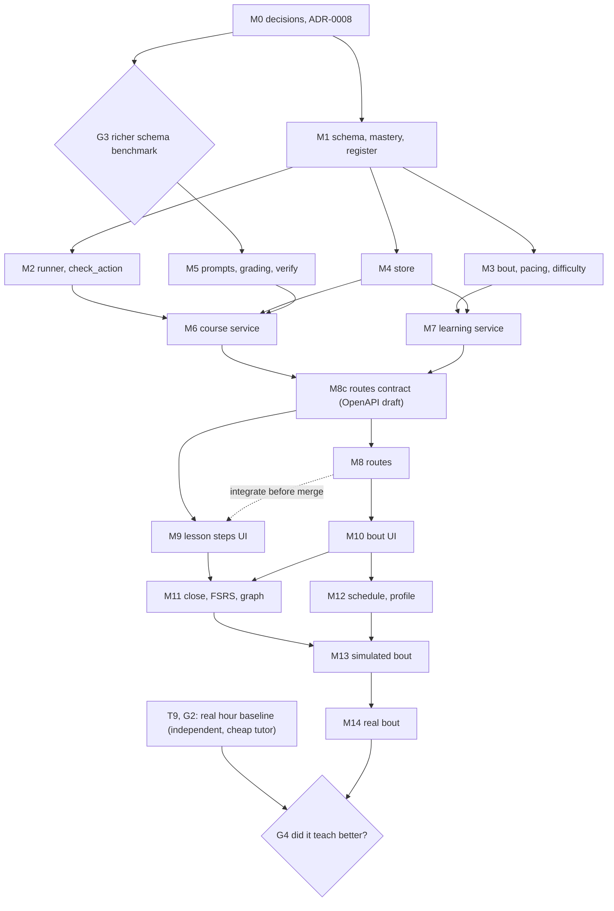

# Learning Method Task DAG

Back to [Learning Method Plan](/learning-method/index.md). Related: [Features](/learning-method/features.md), [Architecture and Folders](/learning-method/architecture.md), [Global Task DAG](/tasks/index.md).

Branch flow as in `CLAUDE.md`: `prod <- staging <- pratham404/<task-id>`. `make gate` before each merge. Nothing merges to `prod` without the owner's say.

T6 is merged (`49977e3`); T9 and G2 (the cheap tutor's real-hour test and owner verdict) are the only cheap-tutor work left, and they run independently of M0–M14 — they feed the baseline G4 compares against, they do not gate the start of this plan. **G3 need not precede M1**: M1 is `lp-core` schema and mastery logic, unaffected by whether the richer Author schema parses cleanly; only M5 (prompts that depend on the richer schema) waits on G3. **M9 may start once M8c freezes the OpenAPI contract for its routes**, using MSW fixtures against that contract, rather than waiting for M8's handlers to be implemented and merged; it still integrates against the real M8 routes before M11.

## M0: decisions and ADR

**Files:** `brain/decisions/0008-learning-method.md`, `brain/tasks/index.md`.
**Contents:** records the shipped defaults for the reveal rule and the 90-minute lock (see the [Plan](/learning-method/index.md)) as tunable settings. Writing the ADR does not block on owner sign-off; the defaults ship, and the owner can change them from settings at any time.
**Accept:** ADR recorded, `make okf` clean.

## G3: richer schema benchmark

**A decision gate. Costs about 6 Opus calls.** The new fields add output, and that cost is unmeasured.

**Files:** `bench/cheap_tutor/round5.py`, new author prompt draft.
**Run:** 10 lessons on Spanish, Rust and one new non-language topic, each twice.
**Continue if:** every run parses, output stays under about 28,000 tokens, late lessons stay within 1 judge point of early ones, and angles do not state the answer.
**If not:** keep the current Author call and add a Haiku enrichment pass for predictions, angles and rubrics. Measure it the same way.

## M1: schema, mastery, register

**Features:** F14, F19, F35 logic, and schema for the rest.
**Files:** `lp-core/src/course.rs`, `method/{mod,mastery,register,recall,dag,probe}.rs`.
**Tests:** proptest: any event prefix folds; replay is deterministic; MC alone never confirms; MC and recall on the same turn never confirm; a miss always returns to `open`; a prediction never affects mastery; "I don't know" adds no register row; courses written before this plan load.
**Accept:** `make gate`, `lp-core` stays free of IO and async.

## M2: runner and gates

**Features:** F05, F07, F09, F10, F11, F12, F13, F16, F17, F18, F20, F21, F27.
**Files:** `lp-core/src/course.rs`, `method/mod.rs`.
**Tests:** proptest over random learners: no teaching before plan confirmation; no explanation before its prediction; no quiz before its notes gate; every third quiz is mixed where earlier items exist; flagged or contradicted items never appear; a learner can always reach Close; `PrereqInserted` into a confirmed plan re-runs the cycle check, keeps the order of already visited lessons, and is rejected if it would create a cycle or reorder a visited lesson. `check_action` rejects every out-of-order action.
**Accept:** `make gate`, with one table test per gate.

## M3: bout, pacing, difficulty

**Features:** F23, F24, F26. (F28 random reward is deferred past G4; `pacing.rs` still owns gap-pause timing for F24.)
**Files:** `lp-core/src/method/{bout,pacing,difficulty}.rs`.
**Tests:** idle rewind with a floor of 0; limits span courses; the gap average stays near the setting over many seeds, with no fixed interval; same seed gives same schedule; difficulty changes only outside the band.
**Accept:** `make gate`.

## M4: store

**Features:** storage for F01, F04, F19, F23, F31, F34.
**Files:** `lp-store/src/{learning,courses,lib,tests}.rs`.
**Tests:** torn tail recovery, concurrent append, two workspaces stay isolated.
**Accept:** `make gate`.

## M5: prompts, grading, verify

**Features:** F06, F08, F15, F18, F20.
**Files:** `lp-agent/src/course/{mod,verify}.rs`, `prompts/*`.
**Tests:** `FauxEngine` for parse, repair, batches and fallback. **A verdict whose quote is not on the fetched page is forced to `unknown`.** A learner answer containing instructions stays fenced as data.
**Accept:** `make gate`. Real-model checks stay in `bench/`.

## M6: course service

**Features:** wires F05 to F21 and F29 to F32.
**Files:** `lp-service/src/course/{mod,plan,grading,verify_job,close,tests}.rs`, `review.rs`.
**Tests:** every action passes `check_action`. A contradicted claim hides its items. With all providers limited, recall stays pending, and a later grader run can confirm it. On a non-Claude fallback, grading drops to one batch per bout.
**Accept:** `make gate`.

## M7: learning service

**Features:** F01 (slots and tracking only, no `.ics`), F02, F03, F04, F23, F34. (F33 rest prompt is deferred past G4.)
**Files:** `lp-service/src/learning/*`, `paths.rs`.
**Tests:** a new bout inside the 2-hour gap is refused; a daily override works once and is logged; heartbeat restores the clock after restart.
**Accept:** `make gate`.

## M8c: routes contract

**Files:** `docs/web/03-server-api.md` draft, `web/openapi/` draft, MSW fixtures for the new routes.
**Contents:** freezes request/response shapes for the new course and learning routes before M8's handlers exist, so M9 can build against typed MSW fixtures in parallel with M8's implementation.
**Accept:** OpenAPI draft merges; M8 and M9 can both start.

## M8: routes

**Files:** `lp-server/src/routes/{courses,learning,mod}.rs`, `dto/*`, `app.rs`, `openapi.rs`, `docs/web/03-server-api.md`, `web/openapi/`.
**Tests:** a route test for each gate returning 409 with its code. No `unwrap()`, and blocking work uses `spawn_blocking`.
**Accept:** `make gate`, `make api-check`.

## M9: lesson steps UI

Starts against M8c's contract; integrates against real M8 routes before M11.

**Files:** `web/src/features/course/{Lesson,Placement,PlanReview,MasteryBar,RegisterPanel}.tsx`, `steps/*`, `docs/web/06-screens.md`.
**Tests:** MSW typed by `components["schemas"]`, with no response-rewriting shims. The answer never appears in a question payload or the DOM before grading.
**Accept:** a full lesson works with all model calls refused, and no method rule exists in TypeScript.

## M10: bout UI

**Files:** `web/src/features/learning/{ReadyGate,SleepCheckin,BoutClock,GapPause,LockedScreen,use-focus-guard}*`. (`Reward.tsx` is deferred with F28.)
**Tests:** refreshing during a gap or lock cannot escape it; breathing is never required and shows its warning; keyboard and reduced-motion work.
**Accept:** `make e2e`.

## M11: close, FSRS, graph

**Features:** F29, F30, F31, F32, F35. (F33 rest prompt and F36 learning proof are deferred past G4.)
**Files:** `web/src/features/course/Close.tsx`, `features/graph/`, `lp-service/src/course/close.rs`.
**Tests:** only confirmed facts reach the graph; sure-and-wrong returns to the first rung; a review done here shows in Review and the reverse; the first test is at most 1 day out.
**Accept:** `make e2e`.

## M12: schedule, profile

**Features:** F01 (no `.ics`), F34.
**Files:** `web/src/features/learning/{ScheduleScreen,ProfileScreen,api}*`, new routes, `lib/nav.ts`.
**Accept:** `make e2e`.

## M13: simulated bout

**Tests:** `FauxEngine` plus Playwright: a 90-minute simulated bout from ready gate to Close, with injected misses. Assert the order of every step, the model-call count, and the lock afterwards. Repeat with every provider limited.
**Accept:** at most 2 strong calls and at most 22 cheap synchronous calls in the bout (the fact-check background job is not counted here, see Budget), with the simulated token estimate under 100,000 including fact-check.

## M14: real bout

The owner studies a new topic in a full bout with the method on, using real CLIs. Pre-test, post-test, and the same test one week later. Runs independently of, and in parallel with, T9/G2's cheap-tutor baseline — both feed G4.

## G4: did it teach better?

| Check | Pass |
|---|---|
| Limits | Never stopped by a provider limit |
| Usage | Under 100,000 tokens on the meter, at most 2 strong calls and 22 cheap |
| Learning | Post-test gain and one-week retention beat the T9 baseline |
| Gates | Owner does not find any gate pointless. Each one they do gets cut or softened. |
| Owner's verdict | "I learned more, and would do it again" |

One learner proves little scientifically, and different topics are not directly comparable, but the decision is about this owner. On a fail, read what failed before writing more code. A gate that annoys without helping should be cut, however good its theory.

## Value order

If time runs short, in order:

1. **M1, M2, M5, M6, M9:** the mastery bar and teach loop, the core of Alvar.
2. **M3, M7, M10:** bout limits and pauses, the core of Huberman.
3. **M11:** Close, which makes learning last across days.
4. **M12:** schedule and profile.

F22 figures, F25 focus guard, F28 random reward, F33 rest prompt, F36 learning proof, F01's `.ics` export, F37 textbook mode and F38 pace bar stay out of this DAG until G4 passes.
