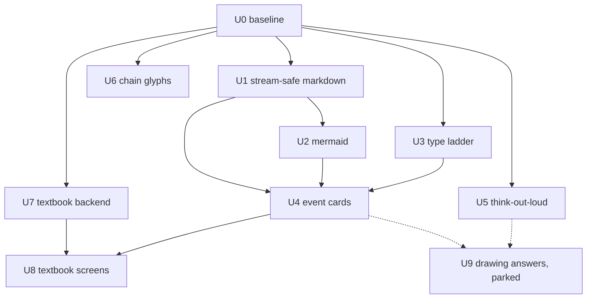

# UI Polish Task DAG and Worktree Flow

Back to [UI Polish Plan](/ui-polish/index.md). Test detail: [Test Plan](/ui-polish/test-plan.md). Routing source: `.claude/skills/orca-model-matrix/SKILL.md`.

File paths below were read on 2026-11-11. A worker confirms each path with `git ls-files` before editing; a path that moved is fixed in the same commit and noted in the task summary.

## DAG

## Worktree rules

1. One worktree per task: `git worktree add ../learnpuppy-wt-<id> -b pratham404/<id>-<slug> staging`.
2. At most 4 workers at once. Start with `tribe post` and `tribe run`; check `tribe status`.
3. Before each commit: `make gate` in that worktree. Web packages also run `bun run test` and `bun run build` inside `web/`.
4. Merge: from the main worktree, `git merge --no-ff pratham404/<id>-<slug>` into `staging`, then run `make gate` once more.
5. **Cleanup after every merge:** `git worktree remove ../learnpuppy-wt-<id>`, `git branch -d pratham404/<id>-<slug>`, `tribe clean` for stray workers. A worktree or worker left over after its task is a bug.
6. Generated `web/openapi/openapi.json` and its TypeScript client are never hand-merged. On a conflict after rebase, regenerate them (the `openapi` subcommand, then `web/scripts/gen-api.ts`) and commit the result. Server DTO work in U3, U4, U5 and U7 lands in merge order; the next worker rebases first.
7. Shared files have one owner: `web/src/features/classroom/Message.tsx` is U4's. Others export components, U4 wires them.

## Wave 0

### U0 Baseline

- **Do:** a Playwright spec that opens a seeded classroom, a course lesson and the digest, and saves screenshots at 1440 and 390 px, light and dark, to `web/e2e/.shots/` (new, added to `.gitignore`; `web/e2e/perf/` is tracked and stays untouched). Record `bun run build` chunk sizes into `brain/ui-polish/baseline.md`. Add a streaming fixture: one assistant message delivered in 12 chunks that contains a fence, `$$ x^2 $$`, a table and a Mermaid block.
- **Files:** `web/e2e/specs/ui-baseline.spec.ts`, `web/e2e/serve/*` (seed only if missing), `.gitignore`, `brain/ui-polish/baseline.md`.
- **Accept:** spec passes under `make e2e`; baseline numbers committed; no source change.
- **Route:** Codex medium.

## Wave 1 (U1 and U3 parallel; U2 starts after U1 merges, because both touch `MarkdownView.tsx`)

### U1 Stream-safe markdown

- **Do:** `completePartial(text)` closes an open code fence, an odd `$$`, an unclosed `**` or backtick, and trims a dangling `[text](` link, so a half-streamed message never flashes raw syntax. Apply it only while the message is still streaming. Do not rewrite finished text.
- **Files:** `web/src/components/app/markdown/partial.ts` (new), `MarkdownView.tsx`, `web/src/features/classroom/StreamingText.tsx`; use the existing `math-source.ts` conventions.
- **Accept:** each of the 12 fixture chunks renders without raw `$$`, backticks or stray `**`; a finished message is byte-identical before and after; streaming the fixture shifts layout by at most 24 px total (measured with a `PerformanceObserver` layout-shift check in Playwright).
- **Tests:** table-driven unit tests for `completePartial` (fence, `$$`, `$`, bold, link, nested list, text inside a code fence left untouched); a component test that feeds chunks; the fixture from U0.
- **Decision gate:** if the tests show cases the helper cannot cover, open a note in [Review Log](/ui-polish/review.md) and evaluate `streamdown` against the bundle budget. Do not adopt it by default.
- **Route:** Codex medium.

### U2 Mermaid block

- **Do:** a fenced block tagged `mermaid` renders as SVG. `mermaid` loads in its own lazy chunk on first use. `securityLevel: "strict"`, `htmlLabels: false`, the SVG passed through DOMPurify (add `dompurify` if absent) before it enters the DOM, theme follows light or dark, a parse error shows a small error card with the source and a Copy button instead of an empty box. Render inside a size-capped, scrollable container, with an `aria-label` and the source as text for screen readers.
- **Files:** `web/package.json` (add `mermaid` pinned to an exact version; check its publish date with `npm view mermaid time` is at least 14 days old), `docs/web/04-frontend-foundation.md` (add `mermaid` to the lazy list), `web/src/components/app/markdown/MermaidBlock.tsx` (new), `MarkdownView.tsx` (route the `mermaid` lang to it; rebased on U1), its own `web/src/components/app/markdown/mermaid.css` (never `styles.css`, which U3 owns).
- **Accept:** valid diagram renders; broken diagram shows the error card; main chunk grows by under 2 kB gzip; `mermaid` chunk is not fetched on pages without one.
- **Tests:** component tests with a valid and an invalid diagram (mock `mermaid` in jsdom, real in one Playwright spec); a bundle check that the main chunk stays in budget; XSS cases: a `click` directive, a `<foreignObject>` script, a `javascript:` link and an `` label, each asserted inert after sanitising.
- **Route:** Codex medium.

### U3 Type ladder and reading font

- **Do:** define the modular type ladder as CSS tokens (one size and line-height per rung, 11 to 32 px, as in `docs/web/05-design-and-motion.md`). Lesson prose, chat messages and digest text use `--font-prose`; chrome, code and numbers stay mono. Add a `readingFont` setting (`sans`, `serif`, `mono`), default `sans`. Bundle a latin woff2 subset locally; no CDN. Titles stay in the heading font; no serif in v1.
- **Files:** `web/src/index.css`, `web/src/styles/tokens.css`, `web/src/components/app/markdown/styles.css`, `readingFont` is a per-workspace setting like the others: `crates/lp-service/src/settings.rs`, DTO in `crates/lp-server/src/dto`, `web/openapi/openapi.json` regenerated, `web/src/features/settings/*`.
- **Accept:** `web/scripts/contrast.ts` still passes; light and dark; RTL unchanged; setting persists after reload; no layout shift on font load (`font-display: swap` plus a size-adjusted fallback); font files add under 60 kB to first load.
- **Tests:** token snapshot test, `web/scripts/contrast.ts`, settings round trip (Rust unit plus web test plus OpenAPI drift check), Playwright screenshot diff against U0.
- **Route:** Claude medium (judgement on spacing and rhythm).

## Wave 2

### U4 Event cards

- **Do:** one compact card per event kind: quiz asked, job running or done, visual ready, steer, probe done. A card is a presentational component fed by the existing DTOs; no new server fields unless a DTO lacks a title or status, in which case add them in `lp-server/src/dto` and regenerate `web/openapi/openapi.json`.
- **Files:** `web/src/features/classroom/Message.tsx`, `MessageList.tsx`, `JobsPanel.tsx`, new `web/src/features/classroom/cards/*.tsx`, `QuestionRecap.tsx` reused for quiz asked.
- **Accept:** each kind has a distinct icon and one-line summary; running jobs show a live state and finish to done; keyboard focusable; reduced-motion respected; no card shows a correct answer before it is submitted (the DTO leak rule).
- **Tests:** a component test per card kind; a leak test that scans rendered DOM of an unanswered quiz for the correct option text; Playwright path from question to verdict.
- **Route:** Codex medium. Depends on U1, U2, U3.

### U5 Think-out-loud field and dictation

- **Do:** an optional "explain your thinking" textarea under each question; its text is saved with the answer (the DTO already carries free text for some questions; extend only if missing). A mic button uses the browser Web Speech API only when `SpeechRecognition` exists; it appends text and never auto-submits. **Privacy:** in Chrome the audio goes to the browser vendor's speech service, not to LearnPuppy. The mic is off until the learner turns it on, and the first use shows that notice. Hidden when unsupported.
- **Files:** `web/src/features/classroom/dock/TextQuestion.tsx`, `ChoiceQuestion.tsx`, new `ThinkingField.tsx`, `use-dictation.ts`; server DTO only if the field is missing.
- **Accept:** field is optional and never blocks submit; dictation toggles cleanly, stops on blur and on submit; works with the existing draft-saving in `dock/drafts.tsx`; zero model calls caused.
- **Tests:** component tests with a mocked recogniser; draft persistence test; confirm LearnPuppy itself makes no extra request on dictation (the browser's own speech traffic is disclosed, not tested).
- **Route:** Codex medium.

### U6 Chain connectives as KaTeX glyphs

- **Do:** render `∧` and `⟹` in the chain table through KaTeX (`\land`, `\implies`) with a small cached helper; keep the plain-text form as `aria-label`.
- **Files:** `web/src/features/graph/ui/*` chain table component, new `web/src/components/app/markdown/latex-glyph.tsx`.
- **Accept:** glyphs visible in light and dark; screen reader reads the plain sentence; KaTeX loads through the existing lazy loader, never in the main chunk.
- **Tests:** component test and a11y check.
- **Route:** Codex low.

### U7 Textbook mode backend (F37 part 1)

Plan owner first: Claude high writes the spec as a sealed artifact; a goldfish reviews it; then Codex builds.

- **Do:**
  1. **Page map.** The PDF job already extracts one string per page with `pdftotext`. Add a chapter map: take headings from the PDF outline when present (outline targets are physical page indices, so no offset is needed), else a single cheap-tier call over the first pages and the table of contents. A printed-number to physical-page offset is detected from the first page that carries a printed number, to handle roman-numeral front matter. Store `chapters[] = {title, startPage, endPage}` per source, physical pages.
  2. **Objectives and items.** One cheap-tier call per chapter at import returns 5 to 12 objectives **and** their quiz items together, as data, with source page ranges. A chapter over about 8,000 words is split into at most 3 parts, each its own call, so one reply never carries too much output; parts count against the cap below. All stored (course-as-data), so studying costs zero model calls. The chapter map uses the PDF outline (0 calls); only when there is no outline is one extra call made for the whole book.
  3. **Reading check.** `POST` an "I read chapter N" intent; the server selects objectives for that chapter and returns a quiz from stored items. Results grade by code, never by the model, and feed FSRS cards through the existing review service.
  4. **Budget.** Import is a one-off cost, exempt from the G4 per-hour cap but counted on the usage route and capped at 40 cheap calls per book including split parts (the rest are queued and imported on request). Studying and the reading check stay at 0 calls.
  5. **Job lifecycle.** Import runs as a workbench job on the existing `jobs` route and SSE events, not as a blocking request. `POST` returns 202 with a job id; the job reports chapter-level progress, retries a failed chapter on its own, and can be cancelled. U8 reads status from the same job and event stream.
  6. **Safety.** Extracted text is untrusted: strip control characters, cap per-chapter text, redact secrets before any model call, keep the 50 MB upload limit and the PDF magic check.
- **Files (confirm by `git ls-files`):** `crates/lp-agent/src/workbench/adapters.rs` and `jobs.rs` (page text, outline), new `crates/lp-core/src/textbook.rs` (types, objective and chapter structs, no IO), `crates/lp-store` (a `textbook.jsonl` ledger, append-only like the others), `crates/lp-service/src/course/` or a new `textbook.rs`, `crates/lp-server/src/routes/sources.rs` plus a new `routes/textbook.rs`, DTOs, `web/openapi/openapi.json`.
- **Accept:** an O'Reilly-style PDF of 400+ pages imports without blocking the server; chapter list is correct on the fixture, including a two-column page, an image-only page and roman-numeral front matter; importing the same PDF twice creates no duplicates; each objective has stored items; reading check makes zero model calls; torn tail and concurrent append tests pass; `make gate` green.
- **Tests:** `lp-core` unit and `proptest` for page-range invariants; store tests for torn tail and workspace isolation; service tests with `FauxEngine`; route oneshot tests including upload rejection and a DTO leak test; one fixture PDF under `crates/lp-service/tests/fixtures/` (new folder; small, license-clean, generated by us); a real-model smoke added to `scripts/real_smoke.py` (manual, not CI).
- **Route:** Claude high for the spec, Codex medium for the build.

## Wave 3

### U8 Textbook mode screens (F37 part 2)

- **Do:** upload flow shows chapters with page ranges; "Check I read chapter N" starts the quiz; per-chapter status (not read, checked, due) comes from FSRS state; a digest line "chapters due". Reuses the course quiz components.
- **Files:** new `web/src/features/textbook/*`, route in `web/src/routes/`, palette entry via `web/src/features/palette/contrib.ts`, MSW fixtures and handlers.
- **Accept:** works against MSW first, then `VITE_API=real` in e2e; keyboard path complete; empty, loading, error and partial-import states exist.
- **Tests:** component tests, MSW handler tests, Playwright e2e with the fixture PDF, axe check.
- **Route:** Claude medium. Depends on U7.

### U9 Drawing answer type (parked: needs a stored image field and an upload path; revisit after the owner's verdict)

- **Do:** a canvas answer for "sketch it" questions: pen, eraser, undo, clear; the PNG is stored with the answer and shown in the recap; **self-graded** by default, so no vision call. Touch and pen supported. Cut this package first if time runs short.
- **Files:** new `web/src/features/classroom/dock/DrawQuestion.tsx`, server answer DTO and store field for an image attachment, size cap 1 MB.
- **Accept:** stroke, undo and save work with mouse and touch; image survives reload; capped size enforced server-side; keyboard fallback is a text answer.
- **Tests:** component tests with a mocked canvas, a server test for the size cap, one Playwright spec.
- **Route:** Codex medium.

## Parked

Plugin API, Electron packaging, find-in-session and the keyboard map overlay. Revisit after the owner's verdict.
