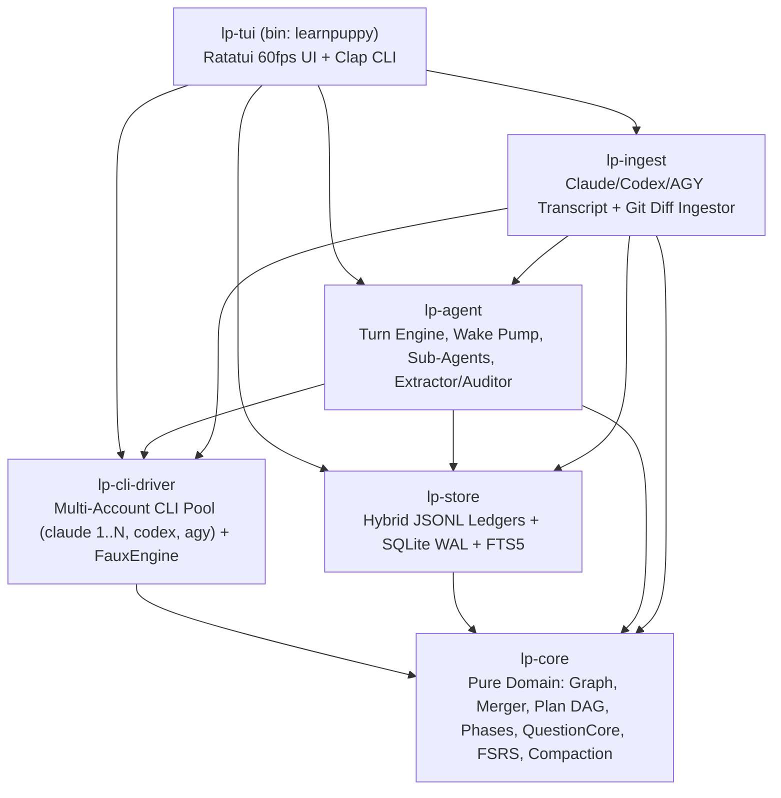
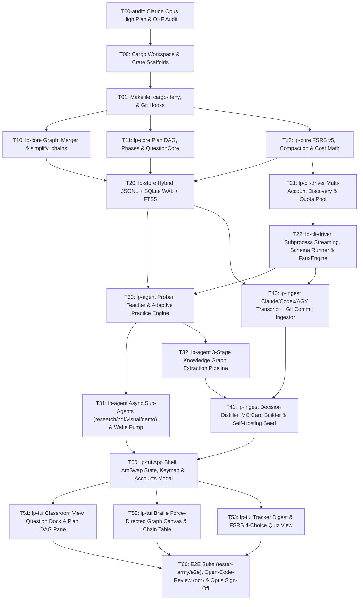

# LearnPuppy (`learnpuppy`) — Master Architecture & Phase-Wise Execution Plan

**Project Path**: `/Users/pratham/code/learnpuppy`  
**Reference Codebases**:
- [`amosblomqvist/learnharness`](https://github.com/amosblomqvist/learnharness.git) (Reverse-engineered via [`morluto/rea`](https://github.com/morluto/rea) in [`docs/REVERSE_ENGINEERING.md`](./REVERSE_ENGINEERING.md))
- `/Users/pratham/code/tracker` (Local CLI session ingestion, decision distillation, FSRS spaced-repetition digest)
- `/Users/pratham/code/bunfiiliate` & [`PrathamBhavsar/perma-brain`](https://github.com/PrathamBhavsar/perma-brain) (OKF brain structure, Orca multi-agent orchestration, Ponytail discipline)

---

## 0. Executive Summary & Product Vision

**LearnPuppy** is a pure-Rust, zero-Electron, single-binary CLI + 60fps Terminal User Interface (`ratatui`) learning harness and spaced-repetition engine. It combines:
1. **100% of `learnharness`'s cognitive pedagogy**:
   - **Prober -> Teacher split** (`probe_done` seam tool, strand floor/ceiling assessment).
   - **Formal Dependency Plan DAG** (`plan_init` Mermaid-subset parser, derived `current`/`visited`/`upcoming` node status from `quiz`/`explain` calls).
   - **One Reasoning Step + Mandatory Graded Check Rhythm** (`probe`/`recall` and `quiz`/`explain` with seeded Fisher-Yates option shuffling, `1..5` confidence slider, and dual `readingThinking` + `thinking` channels).
   - **Async "Ack Now, Steer Later" Sub-Agents** (`researcher`, `pdf-reader`, `visual-maker`, `demo-builder` with deterministic `steer_<jobId>` wake delivery and process-wide 3-permit concurrency semaphore).
   - **Global Cross-Session Knowledge Graph** (3-stage `Extractor -> Verdicts-Only Auditor -> Deterministic Merger` with transitive ancestry-cover `simplify_chains`, birth-session clustering, Braille force-directed Graph Canvas, and 3-level collapsible Chain Table).
   - **Adaptive Practice Sessions** (`problem`/`conclude` tools, committed `modelSolution`, `R0..R5` hint ladder, miss classification, and retest queue).
2. **Zero-Config Local CLI Authentication & Multi-Account Pool**:
   - Automatically detects and uses local CLI logins already active on the machine:
     - **Claude Code (`claude`)**: Discovers **every distinct Claude subscription account** on disk (`~/.claude`, `~/.claude-accounts/*`, `~/.claude-work`, plus user-configured `CLAUDE_CONFIG_DIR` profiles), reading `.claude.json` (`oauthAccount.accountUuid`, `emailAddress`, `seatTier`, `userRateLimitTier`) and treating each as an **independent rate-limit bucket** with automatic failover, cooldown tracking, and quota telemetry.
     - **Codex CLI (`codex`)**: Auto-detects `~/.codex/auth.json` (`chatgpt` mode, e.g., `gpt-5.4`) and executes via sandboxed `codex exec`.
     - **Antigravity CLI (`agy`)**: Auto-detects `~/.gemini/oauth_creds.json` and executes via sandboxed `agy -p --output-format json`.
     - **Optional BYOK HTTP Fallback**: Direct OpenAI/Anthropic/OpenRouter HTTP streaming via `reqwest` when API keys are configured.
3. **Learn From Your Own Local CLI History & Codebases (`/Users/pratham/code/tracker` Port)**:
   - Incrementally ingests local transcripts from Claude (`~/.claude/projects/**/*.jsonl` across all accounts), Codex (`~/.codex/sessions/**/*.jsonl`), and Antigravity (`~/.gemini/antigravity-cli/conversation_summaries.db` via safe temp snapshot copy), joined with Git commits/diffs from allowlisted repos (starting with `/Users/pratham/code/tracker` and `/Users/pratham/code/bunfiiliate` to teach **System Design** and **Rust**).
   - Distills architectural decisions (`what`, `why`, `basis`, `alternatives`, `risk`), folds them into the Knowledge Graph, and generates self-contained 4-choice FSRS v5 spaced-repetition cards (`why`, `predict`, `bug`, `trace`, `ownership`, `cloze`).

---

## 1. System Architecture & Workspace Crate Topology

LearnPuppy is organized as a **6-crate Cargo workspace** enforcing strict hexagonal dependency rules (inner crates never depend on outer crates; `lp-core` has zero IO or async dependencies):

```
learnpuppy/
├── Cargo.toml                  # Workspace root, shared dependencies, lint table, release profile
├── deny.toml                   # cargo-deny license, advisory, and duplicate-crate policy
├── Makefile                    # Gate runner: fmt, clippy, test, deny, okf-validate, e2e, ocr
├── docs/
│   ├── PLAN.md                 # This master plan
│   └── REVERSE_ENGINEERING.md  # Clean-room REA + source spec of learnharness & tracker
├── brain/                      # OKF v0.1 knowledge bundle (validated with --strict)
└── crates/
    ├── lp-core/                # Pure domain contracts, state machines, parsers, algorithms (0 IO)
    ├── lp-store/               # Hybrid append-only JSONL + SQLite WAL + FTS5 persistence engine
    ├── lp-cli-driver/          # Multi-account CLI auth discovery, quota pool, LlmEngine trait + FauxEngine
    ├── lp-agent/               # Prober/Teacher/Practice loops, Wake pipeline, Extractor->Auditor->Merger
    ├── lp-ingest/              # Claude/Codex/AGY transcript + Git commit ingestor & FSRS card generator
    └── lp-tui/                 # Ratatui 60fps TUI + clap CLI binary (`learnpuppy`)
```

### 1.1 Dependency Graph & Hexagonal Boundaries



### 1.2 Production Code Abstractions (Ports & Traits in `lp-core` and `lp-cli-driver`)

To guarantee deterministic testing, zero vendor lock-in, and clean separation of concerns, every boundary uses explicit Rust traits:

1. **`LlmEngine` Trait (`lp-cli-driver`)**:
   ```rust
   #[async_trait]
   pub trait LlmEngine: Send + Sync {
       /// Stream a conversational or tool-calling turn (used by Prober, Teacher, Practice).
       async fn stream_turn(
           &self,
           req: TurnRequest,
           event_tx: mpsc::Sender<StreamDelta>,
           cancel: CancellationToken,
       ) -> Result<TurnResponse, DriverError>;

       /// Execute a structured JSON-schema completion (used by Extractor, Auditor, Distiller, CardBuilder).
       async fn complete_structured<T: DeserializeOwned + JsonSchema + Send>(
           &self,
           req: StructuredRequest,
           cancel: CancellationToken,
       ) -> Result<StructuredOutput<T>, DriverError>;
   }
   ```
   - **Production Implementations**:
     - `CliPoolEngine`: Routes across discovered `claude` accounts (`CLAUDE_CONFIG_DIR`), `codex`, and `agy` subprocesses with automatic quota failover.
     - `HttpApiEngine`: Optional BYOK OpenRouter/Anthropic/OpenAI SSE streaming driver.
   - **Deterministic Test Implementation**:
     - `FauxEngine`: Scriptable in-memory queue (`faux_text`, `faux_tool_call`, `faux_structured`, `FauxStreamControl` barrier) enabling millisecond-fast unit and E2E tests with zero network/CLI calls.

2. **Storage Port Traits (`lp-core::ports`)**:
   - `ChatStore`: Load/save `ChatRecord`, atomic append to `turns` and `extractions` usage logs, list `ChatSummary` items.
   - `GraphStore`: Append/read `GraphNode` (`nodes.jsonl`), `GraphChain` (`chains.jsonl`), `CoverageEntry` (`coverage.jsonl`), `SessionCheckpoint` (`sessions.jsonl`), atomic `rewrite_chains`, and FTS5 `search_propositions`.
   - `JobStore`: Create/update `JobRecord`, atomic `claim_steers(chat_id)`, crash-recovery scan for interrupted jobs.
   - `TrackerStore`: Incremental cursor store (`ingest_cursors`), `CodingSession`, `DecisionRecord`, `BookChunk`, `FlashCard`, `FsrsReviewLog`, and `sync-<device>.jsonl` replication.

---

## 2. Multi-Account CLI Authentication & Quota Pool (`lp-cli-driver`)

A centerpiece requirement of LearnPuppy is **seamless, zero-config CLI authentication** that automatically picks up active `codex`, `claude`, and `agy` logins on the host computer — and explicitly counts **separate Claude subscription logins as separate Claude accounts** with independent rate limits.

### 2.1 Auto-Discovery Matrix

On startup (and via `learnpuppy auth status` / `learnpuppy auth scan`), `lp-cli-driver` inspects the local environment without ever prompting for macOS Keychain GUI popups:

| Provider | Discovery Paths | Identity & Metadata Extracted | Subprocess Invocation |
|---|---|---|---|
| **Claude Code (Multi-Account)** | 1. `~/.claude` + `~/.claude.json`<br>2. `~/.claude-accounts/*/` (e.g. `account2`)<br>3. `~/.claude-work/`<br>4. `$CLAUDE_CONFIG_DIR`<br>5. Custom paths in `~/.learnpuppy/settings.json` | Reads `<dir>/.claude.json` -> `oauthAccount`: `accountUuid`, `emailAddress` (e.g. `pratham.bhavsar501@gmail.com` vs `q97159745@gmail.com`), `seatTier`, `userRateLimitTier`, `organizationUuid`. Deduplicates by `accountUuid`. | `env -i HOME=$HOME PATH=$PATH CLAUDE_CONFIG_DIR=<dir> claude -p --output-format stream-json --verbose --model <model> --strict-mcp-config` (or `--output-format json --json-schema <schema>` for structured calls). |
| **Codex CLI** | `~/.codex/auth.json` + `~/.codex/config.toml` | Reads `auth_mode` (`chatgpt`), decodes JWT payload (`email`, `chatgpt_plan_type`, `chatgpt_account_id`), default `model` (`gpt-5.4`). | `codex exec --json --skip-git-repo-check -C /tmp/lp-empty-sandbox -m <model> -` (with `--output-schema <file>` when structured). |
| **Antigravity (`agy`)** | `~/.gemini/oauth_creds.json` + `~/.gemini/google_accounts.json` | Reads active Google account email, token expiry, and supported models (`claude-opus-4-6-thinking`, `claude-sonnet-4-6`, `gemini-3.1-pro-high`, `gemini-3-flash`). | `agy -p <prompt> --output-format json --json-schema <schema> --effort <level> --sandbox --model <model>`. |
| **BYOK API Keys (Optional)** | `~/.learnpuppy/auth.json` or `ANTHROPIC_API_KEY` / `OPENAI_API_KEY` / `OPENROUTER_API_KEY` | Key fingerprint + provider catalog. | Direct HTTPS via `reqwest`. |

### 2.2 Per-Account Quota Tracking & Failover Scheduler (`AccountPool`)

Each discovered account is assigned a stable `AccountId` (e.g. `claude:pratham.bhavsar501@gmail.com`, `claude:q97159745@gmail.com`, `codex:yadavkumar49900@gmail.com`, `agy:default`):

```rust
pub struct AccountState {
    pub id: AccountId,
    pub provider: ProviderKind,        // ClaudeCli, CodexCli, AgyCli, ApiKey
    pub email: Option<String>,
    pub account_uuid: Option<Uuid>,
    pub config_dir: Option<PathBuf>,   // e.g. Some("~/.claude-accounts/account2")
    pub rate_limit_tier: Option<String>,
    pub health: AccountHealth,         // Healthy | Cooldown { until: Instant, reason: String } | AuthExpired
    pub window_requests: u32,
    pub window_input_tokens: u64,
    pub window_output_tokens: u64,
    pub last_used_at: Option<Instant>,
}
```

- **Intelligent Scheduling & Instant Failover**:
  - For any role slot (`strong` for Teacher/Auditor/Distiller, `cheap` for Extractor/CardGen/SubAgents, `fast` for Prober), the user can pin a specific provider or `claude:auto` pool.
  - When `claude:auto` (the default for Claude) is selected and Account 1 (`pratham.bhavsar501@gmail.com`) hits a 5-hour window limit or HTTP 429 / CLI rate-limit message, `AccountPool` parses the reset timestamp (or applies exponential cooldown), marks Account 1 as `Cooldown { until }`, and **transparently retries the turn on Account 2 (`q97159745@gmail.com`)** or falls back to `codex` / `agy` according to the slot's fallback chain!
  - Account usage and cooldown countdowns are persisted in SQLite (`account_usage_ledger`) and displayed live in the TUI Top Bar and Accounts Modal (`Ctrl+A`).

---

## 3. Memory Management, Concurrency, & Storage Engineering

Because LearnPuppy is designed as a **flagship Rust systems portfolio project**, its memory, concurrency, and storage subsystems are engineered to production standards:

### 3.1 Memory Management Model
1. **Lock-Free Read Snapshots via `arc-swap` (`ArcSwap<GraphSnapshot>`)**:
   - The TUI renders at 60fps (16.6ms frame budget). The render thread **never locks a `Mutex`** to read the Knowledge Graph, Chain Table, or Session list.
   - Instead, `AppState` holds an `ArcSwap<GraphSnapshot>` and `ArcSwap<SessionView>`. Background extraction merges and layout ticks compute a new immutable `Arc<GraphSnapshot>` on a worker thread and atomically swap the pointer via `rcu`, giving the TUI wait-free, zero-allocation reads on every frame.
2. **String Interning & Compact Identifiers (`smol_str::SmolStr`)**:
   - Node IDs (`n_a1b2c3d4e5f6`), chain IDs (`arg_...`), chat IDs, and model names are `SmolStr` (stack-inlined up to 23 bytes — zero heap allocation for all IDs!).
3. **Bounded Channels & Backpressure (`tokio::sync::mpsc`)**:
   - Every async channel in the workspace is strictly bounded (`TUI_EVENT_CAP = 256`, `STREAM_DELTA_CAP = 512`, `WAKE_QUEUE_CAP = 64`). Unbounded channels (`mpsc::unbounded_channel`) are banned via `clippy::disallowed_methods` in `Cargo.toml`.
4. **Streaming JSONL Parsers (`BufReader::read_line` reuse)**:
   - When ingesting multi-megabyte Claude/Codex JSONL transcripts, `lp-ingest` reuses a single `String` line buffer across iterations (`buf.clear(); reader.read_line(&mut buf)`) and deserializes borrowed slices with `serde_json`, keeping peak RSS under **35 MB** even when scanning 500+ historical CLI sessions.
5. **Subprocess Lifecycle Hygiene (`kill_on_drop(true)` + Process Groups)**:
   - Every spawned CLI child (`claude`, `codex`, `agy`) is configured with `Command::kill_on_drop(true)`, runs in an isolated empty temp directory (`/tmp/learnpuppy-sandbox`), has `CLAUDECODE` and recursive hook env vars stripped, and is wrapped in a `CancellationToken` select branch so user `Esc` cancellation or app exit reaps the subprocess immediately with zero zombie processes.

### 3.2 Hybrid Storage Architecture (`~/.learnpuppy/`)

LearnPuppy combines the human-auditable, Git/Syncthing-friendly **append-only JSONL ledgers** of `learnharness` with the transactional speed and full-text search of **SQLite WAL** from `tracker`:

```
~/.learnpuppy/
├── settings.json               # Model slot pins, account priorities, allowlisted git repos
├── auth.json                   # Optional BYOK keys (chmod 0600)
├── graph/
│   ├── format.json             # { "version": 1 }
│   ├── nodes.jsonl             # Append-only GraphNode births + link-appends
│   ├── chains.jsonl            # Append-only GraphChain assertions (rewritten atomically on simplifyChains)
│   ├── coverage.jsonl          # Per-message SHA-256 coverage fingerprints
│   ├── sessions.jsonl          # One-shot file import checkpoints
│   └── positions.json          # Settled 2D ForceAtlas2 coordinates per node ID
├── chats/
│   └── <chat_id>.json          # Atomic write-ahead session records (messages, PlanTree, turns, extractions)
├── artifacts/
│   └── <job_id>.{html,svg,md}  # Generated visual/demo/research artifacts
├── sync/
│   └── sync-<device_id>.jsonl  # Append-only multi-device FSRS review & card replication log
└── index.db                    # SQLite (WAL mode, synchronous=NORMAL, foreign_keys=ON)
```

**What lives in `index.db` (SQLite WAL)**:
- **FTS5 Virtual Tables**: `propositions_fts` (instant BM25 + prefix search for the Auditor's `find` tool and TUI `Ctrl+K` palette) and `transcripts_fts` (search across teaching sessions and ingested CLI coding sessions).
- **Tracker & FSRS Tables**: `ingest_cursors` (`source_key`, `mtime_ms`, `size_bytes`), `coding_sessions`, `decisions`, `book_chunks`, `flashcards`, `fsrs_reviews` (append-only review log), and `account_usage_ledger`.
- **Atomic File Writes**: All JSON and ledger rewrites write to `<path>.tmp.<pid>`, call `File::sync_all()`, and atomically `std::fs::rename` over the target path so a power loss or `SIGKILL` never corrupts a chat or ledger.

---

## 4. Curated Rust Crate Stack & Justifications

Every dependency is selected for compile-time reliability, minimal transitive bloat, and idiomatic Rust design:

| Domain | Crate | Version | Why It Is the Best Choice |
|---|---|---|---|
| **Async Runtime** | `tokio` (`rt-multi-thread`, `process`, `fs`, `sync`, `time`, `macros`) + `tokio-util` (`CancellationToken`) | `1.43` / `0.7` | Industry-standard async process management, cancellation tokens, and bounded channels. |
| **Terminal UI** | `ratatui` + `crossterm` + `tui-textarea` | `0.29` / `0.28` / `0.7` | Built-in `widgets::Canvas` with `Marker::Braille` (2x4 sub-cell resolution for the force-directed Knowledge Graph and Plan DAG), zero-flicker diff rendering, and rich multi-line text editing. |
| **Markdown & Code Highlighting** | `pulldown-cmark` + `syntect` | `0.12` / `5.2` | Fast pull-parser for streaming teacher prose, LaTeX math delimiter normalization (`$...$` / `$$...$$` rendered to clean Unicode math symbols `∫, ∑, ∂, ⇒, ∧, ∀, α..ω, ², ₙ`), and syntax-highlighted Rust/system-design code blocks. |
| **Serialization & Schemas** | `serde` + `serde_json` + `schemars` | `1.0` / `0.8` | Compile-time JSON Schema generation (`#[derive(JsonSchema)]`) passed directly to `claude --json-schema`, `codex --output-schema`, and `agy --json-schema`. |
| **Database & Search** | `rusqlite` (`bundled`, `functions`, `vtab`) | `0.33` | Statically links SQLite 3.47+ with FTS5 enabled out of the box; zero external system library dependencies, sub-millisecond queries. |
| **Memory & Concurrency** | `arc-swap` + `smol_str` + `parking_lot` | `1.7` / `0.3` / `0.12` | Lock-free `ArcSwap` snapshots for the 60fps TUI render loop; 23-byte inline `SmolStr` IDs; fast non-poisoning mutexes where needed. |
| **PDF & Web Extraction** | `pdf-extract` (or `lopdf`) + `reqwest` + `scraper` | `0.7` / `0.12` / `0.22` | Pure-Rust local PDF text extraction for `pdf-reader` and book ingestion, plus clean HTML readability scraping for `researcher` without needing Playwright or Poppler. |
| **Hashing & IDs** | `sha2` + `hex` + `rand` (`SmallRng`) | `0.10` / `0.4` / `0.8` | SHA-256 message coverage fingerprints (`coverage.jsonl`) and deterministic seeded Fisher-Yates quiz option shuffling. |
| **CLI & Diagnostics** | `clap` (`derive`) + `thiserror` + `anyhow` + `tracing` + `tracing-appender` | `4.5` / `2.0` / `1.0` / `0.1` | Structured non-blocking file logging (`~/.learnpuppy/logs/learnpuppy.log` so stdout/stderr never corrupt the TUI alternate screen) and ergonomic CLI subcommands. |
| **Testing & Verification** | `proptest` + `insta` + `tempfile` + `expectrl` | `1.6` / `1.42` / `3.15` / `0.7` | Property-based fuzzing of `simplify_chains`, FSRS math, and Mermaid DAG parsing; `insta` snapshot testing of Ratatui `TestBackend` buffers; `expectrl` PTY driving for E2E terminal tests. |

---

## 5. TUI & CLI User Experience Design (`lp-tui`)

### 5.1 TUI Views & Navigation (`Tab` / `1..5` View Switcher)

1. **`[1] Classroom View` (Teaching & Adaptive Practice)**:
   - **Left Sidebar (Collapsible `Ctrl+B`)**: Sessions filter (`Teaching | Practice | All`), live phase badge (`PROBE` / `PLAN` / `TEACH` / `PRACTICE`), spinner when turn or compaction is active, and **Background Sub-Agents Dock** showing live activity lines (`research: "Raft leader lease"`).
   - **Center Main Pane**: Streaming teacher/prober prose with syntax-highlighted code blocks, Unicode math rendering, inline Plan Snapshot cards, and interactive Sub-Agent artifact cards (`Enter` on a demo card opens the interactive TUI parameter explorer or launches the HTML artifact in browser).
   - **Bottom Question & Thinking Dock**:
     - When a `probe` / `quiz` is active: displays shuffled options `[A]..[D]` + `[I] I don't know`, **Confidence Bar (`1..5`: `1=Guess .. 5=Certain`)**, and dual tabs for **Reading Notes (`readingThinking`)** and **Answer Reasoning (`thinking`)**.
     - When `explain` / `recall` / `problem` is active: multi-line `tui-textarea` composer for free-recall or step-by-step problem work (with `Ctrl+H` to request the next `R0..R5` hint rung).
   - **Right Split Pane (Toggle `Ctrl+P`)**: Persistent **Plan DAG Viewport** rendering the session's dependency tree with live derived node badges (`● Current` in glowing cyan, `✓ Visited` in green, `○ Upcoming` in dim gray).

2. **`[2] Knowledge Graph & Chain Table View`**:
   - **Sub-mode A: Interactive Braille Graph Canvas (`g` toggle)**:
     - Renders propositions (`n_...`), implication junctions (`arg_...`), directed edges, and birth-session cluster hulls on a `ratatui::widgets::Canvas` using `Marker::Braille` (`hjkl`/arrows to pan, `+`/`-` to zoom, `/` to fuzzy-jump to any node, `Space` to toggle node into the Practice Selection basket, `Enter` to open the Node Provenance & Aliases Drawer).
   - **Sub-mode B: Collapsible 3-Level Chain Table (`t` toggle)**:
     - Mirrors `learnharness`'s Chain Table: `Level 1: Birth-Session Cluster` -> `Level 2: Reasoning Chain (Premise A ∧ Premise B ⟹ Conclusion C)` -> `Level 3: Full Precision Statements & Provenance Links`.
     - Bottom Selection Action Bar: `s` to start an Adaptive Practice Session on selected chains/nodes, `x` to cascade-delete selected nodes (with blast-radius preview of affected chains).

3. **`[3] Tracker Digest & FSRS Spaced-Repetition View`**:
   - **Sub-tab A: Daily / Weekly CLI Coding Digest**:
     - Lists ingested sessions from `claude` (all accounts), `codex`, and `agy`, grouped by project (`tracker`, `bunfiiliate`, `learnpuppy`, etc.), showing distilled architectural `DecisionRecord`s (`What`, `Why`, `Basis: stated|inferred`, `Alternatives Rejected`, `Risk`, `Commit SHA`).
     - Press `g` on any decision to fold its propositions/chains into the global Knowledge Graph.
   - **Sub-tab B: FSRS 4-Choice Quiz Queue (`Due Today` / `System Design` / `Rust Ownership & Types`)**:
     - Presents due self-contained 4-option MC cards (`why`, `predict`, `bug`, `trace`, `ownership`, `cloze`).
     - After selecting an option (`1..4`), reveals the rationale + source link and grades FSRS retention (`[1] Again  [2] Hard  [3] Good  [4] Easy`), immediately updating the deterministic FSRS schedule and `sync-<device>.jsonl`.

4. **`[4] Accounts & Model Slots View (`Ctrl+A`)**:
   - Displays all auto-discovered CLI logins (`claude #1: pratham.bhavsar501@gmail.com`, `claude #2: q97159745@gmail.com`, `codex: yadavkumar49900@gmail.com`, `agy: default`) with live health status (`Healthy`, `Cooldown (14m left)`), token/turn telemetry, and role slot pins (`prober`, `teacher`, `practice`, `extractor`, `auditor`, `distiller`).

### 5.2 First-Class Headless CLI Subcommands

Every feature is also scriptable from the terminal without opening the TUI (enabling fast E2E testing and CLI automation):
- `learnpuppy` (default): Launch the full-screen 60fps TUI.
- `learnpuppy auth status [--json]`: Discover and verify all `claude` accounts, `codex`, `agy`, and API keys.
- `learnpuppy auth add-claude <path>`: Register an additional `CLAUDE_CONFIG_DIR` profile in the account pool.
- `learnpuppy chat new "<topic>" [--teach|--practice]`: Start or step a session from the CLI.
- `learnpuppy graph stats | search "<query>" | import <file.md|file.pdf>`: Inspect or import notes/books into the Knowledge Graph.
- `learnpuppy ingest [--since 7d] [--repo /Users/pratham/code/tracker]`: Incrementally ingest local Claude/Codex/AGY transcripts + git commits, distill decisions, and mint FSRS cards.
- `learnpuppy review [--limit 15]`: Run an interactive CLI FSRS flashcard review session.

---

## 6. Multi-Agent Orchestration & Ponytail Discipline

Execution strictly follows `/orchestration` (Orca supervisor + isolated git worktrees) and `/ponytail` (smallest complete change, zero speculative bloat, pre-merge verification gates).

### 6.1 Agent Role Assignments
- **Planner & Chief Auditor**: **1x Claude Opus High** (`claude-opus-4-6-thinking` / `claude -p --model opus --effort high`) — audits this plan + `brain/` OKF bundle in Phase 0 (`T00-audit`), and performs final architectural sign-off in Phase 6 (`T60`).
- **Implementation Workers** (spawned via `orca spawn` on isolated worktrees `/Users/pratham/code/learnpuppy-wt-<id>`):
  - **Claude Sonnet 4.6** (`--cli claude --model sonnet`): Complex stateful agent pipelines (`lp-agent`, `lp-ingest`) and Ratatui UI views (`lp-tui`).
  - **Codex (`gpt-5.4`)** (`--cli codex`): Pure mathematical & algorithmic core (`lp-core` graph merger, `simplify_chains`, Mermaid DAG parser, FSRS v5, `lp-store` SQLite/JSONL engine).
  - **Antigravity (`agy`)**: CLI auth discovery & subprocess driver (`lp-cli-driver`), E2E test suites, and documentation/OKF maintenance.

### 6.2 Git Branching & Commit Convention
- **Branch Topology**: `prod <- staging <- feat/T<XX>-<slug>`
  - `prod` is frozen until Phase 6 sign-off.
  - All task branches fork from `staging` (`git worktree add /Users/pratham/code/learnpuppy-wt-T10 -b feat/T10-core-graph staging`) and merge back into `staging` via `git merge --no-ff` only after passing all pre-merge gates.
- **Commit Messages**: Short, direct, lowercase prefix: `feat: <what you did>`, `fix: <what you did>`, `test: <what you did>`, `docs: <what you did>`.

---

## 7. Phase-Wise Task DAG (`T00` – `T60`)



### Phase 0 — Plan Audit & Workspace Foundation
- **`T00-audit` (`Claude Opus High`)**:
  - **Scope**: Audit `docs/REVERSE_ENGINEERING.md`, `docs/PLAN.md`, and `brain/` OKF bundle for missing edge cases, race conditions, or `learnharness`/`tracker` parity gaps; apply any refinements and re-verify `validate.py brain --strict`.
- **`T00` (`Codex` / `AGY`)**:
  - **Scope**: Initialize the 6-crate Cargo workspace (`lp-core`, `lp-store`, `lp-cli-driver`, `lp-agent`, `lp-ingest`, `lp-tui`) with shared dependencies, workspace lints (`unsafe_code = "forbid"`, `clippy::disallowed_methods` banning `unbounded_channel`), and clean compilation.
  - **Gate**: `cargo check --workspace --all-targets`.
- **`T01` (`AGY`)**:
  - **Scope**: Add `deny.toml` (`cargo-deny` license/advisory check), `Makefile` (`make fmt`, `make clippy`, `make test`, `make deny`, `make okf`, `make ci`), and `.gitignore`.
  - **Gate**: `make ci` exits 0.

### Phase 1 — Pure Domain Core (`lp-core`, Zero IO)
- **`T10` (`Codex`) — Knowledge Graph, Deterministic Merger & `simplify_chains`**:
  - **Scope**: Implement `GraphNode`, `GraphChain`, `CoverageEntry`, `SessionFindings`, `AuditVerdicts`, `GraphSnapshot`, `merge_findings`, `simplify_chains` (prefer-fewest-premises + transitive ancestry-cover), `birth_session_partition` (`MIN_CLUSTER_SIZE = 3`), `chains_for_selection`, `resolve_target_id`, `deletion_blast_radius`, and 2D ForceAtlas2 layout settler.
  - **Tests**: Unit tests + `proptest` suites proving `simplify_chains` idempotency, cycle safety, and transitive ancestry reduction (`[A,B]⟹X` + `[X,C]⟹Y` drops `[A,B,C]⟹Y`).
- **`T11` (`Codex`) — Plan DAG Parser, 3-Phase State Machine & Question Core**:
  - **Scope**: Implement Mermaid `graph TD` parser (`plan_init`) with line-numbered errors and cycle path reporting; `derive_plan_statuses` (`current`/`visited`/`upcoming` from `quiz`/`explain` calls); `phase_at_3` (`Probe -> Plan -> Teach`); `probe_done` contract; `quiz_input_problems` & `ask_option_problems`; deterministic seeded Fisher-Yates option shuffler; `heal_encoded_arguments` & `strip_model_value_debris`; and `PracticeGate` (`problem` / `conclude` contracts).
  - **Tests**: Exhaustive unit + property tests covering malformed Mermaid, cycle detection, consecutive same-node quiz calls, revisited nodes (`a -> b -> a`), and double-encoded JSON tool arguments.
- **`T12` (`Codex`) — FSRS v5 Engine, 20k-Token Compaction & Cost/Quota Math**:
  - **Scope**: Implement pure FSRS v5 scheduler + deterministic review-log replay (`request_retention = 0.9`, `enable_fuzz = false`, `enable_short_term = true`); `validate_card_shape` (context-dependent regex guard + `1.6 * mean + 10` option length guard); 20k-token retained-tail compaction cutfinder (preserving `[quiz_call, quiz_answer]` atomicity); and `accumulate_job_usage` / `TurnUsage` cost folds.
  - **Tests**: Deterministic FSRS replay tests matching `tracker/server/digest/fsrs.ts` outputs and compaction boundary tests.

### Phase 2 — Hybrid Storage & Multi-Account CLI Driver (`lp-store`, `lp-cli-driver`)
- **`T20` (`Codex`) — Hybrid JSONL Ledgers + SQLite WAL + FTS5 (`lp-store`)**:
  - **Scope**: Implement `FsGraphStore`, `FsChatStore`, `FsJobStore`, and `SqliteTrackerStore` in `lp-store`. Includes atomic temp-file + `fsync` + rename writes, CRC/corrupt-tail line recovery on JSONL ledgers, SQLite WAL migrations, FTS5 indexing (`propositions_fts`, `transcripts_fts`), `claim_steers` idempotency, and `sync-<device>.jsonl` import/export.
  - **Tests**: Tempdir crash-simulation tests, concurrent reader/writer tests, and FTS5 ranking tests.
- **`T21` (`AGY` / `Sonnet`) — Multi-Account CLI Auth Discovery & Quota Pool (`lp-cli-driver`)**:
  - **Scope**: Auto-discover all local `claude` accounts (`~/.claude`, `~/.claude-accounts/*`, `~/.claude-work`, `$CLAUDE_CONFIG_DIR`), `codex` (`~/.codex/auth.json`), and `agy` (`~/.gemini/oauth_creds.json`). Parse account emails, UUIDs, and tiers without touching macOS Keychain GUI. Implement `AccountPool` with per-account rate-limit windows, 429 cooldown parsing, priority/round-robin selection, and automatic failover across Claude accounts and fallback providers.
  - **Tests**: Fixture directory tests simulating 3 Claude accounts (1 healthy, 1 rate-limited, 1 expired) + Codex + AGY, verifying automatic failover and cooldown recovery.
- **`T22` (`Sonnet`) — Subprocess Streaming Driver, Structured Schema Runner & `FauxEngine`**:
  - **Scope**: Implement `LlmEngine` for `claude -p`, `codex exec`, and `agy -p` with `kill_on_drop(true)`, isolated `/tmp` sandbox working directory, stripped nested env vars, streaming JSON event parsing (`StreamDelta::Text`, `StreamDelta::Thinking`, `StreamDelta::ToolCall`), `--json-schema` / `--output-schema` structured output extraction, optional `reqwest` BYOK driver, and `FauxEngine` for deterministic testing.
  - **Tests**: `FauxEngine` streaming/barrier tests + mock CLI script subprocess tests verifying timeout, cancellation, and zombie-free cleanup.

### Phase 3 — Agent Loops, Sub-Agents & Knowledge Graph Extraction (`lp-agent`)
- **`T30` (`Sonnet`) — Stateless Per-Turn Prober, Teacher & Practice Agent Loops**:
  - **Scope**: Port all prompt fragments from `learnharness/src/agent/prompts/` (`shared`, `prober`, `teacher`, `practice`) into embedded Rust prompt templates (`include_str!`). Implement per-turn agent construction (`ProberAgent`, `TeacherAgent`, `PracticeAgent`), tool registry wiring (`probe`/`recall`, `quiz`/`explain`, `ask_user_question`, `probe_done`, `plan_init`, `problem`/`conclude`, `read`/`ls`/`find`/`grep`), validation-error retry loop, and 20k-token background compaction trigger.
  - **Tests**: Full multi-turn `Probe -> probe_done -> Handoff Wake -> plan_init -> Teach quiz -> Answer -> Next step` lifecycle tests driven by `FauxEngine`.
- **`T31` (`Sonnet`) — Async Workbench Sub-Agents & Deterministic Wake Pipeline**:
  - **Scope**: Implement `bg_llm_semaphore` (3 permits), `run_submit_agent` (max 4 turns with error-back retry), `researcher` (web search + HTML readability), `pdf-reader` (`pdf-extract` page search + read tracking `pagesRead` vs `pagesConsulted`), `visual-maker` (SVG + Unicode box/Braille diagram generator), `demo-builder` (interactive TUI parameter model + standalone HTML artifact), and the Wake Pump (`claim_steers`, idle wake gates, abort steers).
  - **Tests**: Parallel job dispatch tests, pending-question wake deferral tests, learner job abort tests, and crash recovery tests.
- **`T32` (`Sonnet`) — 3-Stage Knowledge Graph Extraction Pipeline (`Extractor -> Auditor -> Merger`)**:
  - **Scope**: Implement per-source serial extraction queue + global FIFO audit-merge mutex; message coverage fingerprinting (`coverage.jsonl`); digest-aware Extractor (`"THE GRAPH SO FAR"`); Verdicts-Only Auditor (`find`, `list_sessions`, `list_propositions` tools -> `{ links }`); deterministic `merge_findings` + `simplify_chains`; and one-shot Markdown/PDF notes import front door (`src_<hash>`).
  - **Tests**: End-to-end extraction tests verifying cross-batch chain assembly, equivalence linking across two sessions, and transitive chain simplification.

### Phase 4 — Local CLI Transcript & Codebase Learning (`lp-ingest`)
- **`T40` (`Codex` / `Sonnet`) — Local Claude (Multi-Account), Codex, AGY & Git Commit Ingestor**:
  - **Scope**: Port and optimize `tracker/server/digest/ingest.ts` in Rust:
    - Scan `~/.claude/projects/**/*.jsonl`, `~/.claude-accounts/*/projects/**/*.jsonl`, and `~/.claude-work/projects/**/*.jsonl` (skipping `subagents/`).
    - Scan `~/.codex/sessions/**/*.jsonl`.
    - Copy `~/.gemini/antigravity-cli/conversation_summaries.db` (+ `-wal`, `-shm`) to a temp snapshot directory (`with_snapshot`) and extract Antigravity sessions + `brain/<id>/*.md` artifacts.
    - Match sessions against git commits/diffs in allowlisted repos (`/Users/pratham/code/tracker`, `/Users/pratham/code/bunfiiliate`, `/Users/pratham/code/learnpuppy`).
  - **Tests**: Fixture tests for Claude, Codex, AGY SQLite snapshot, and git commit time-window matching + incremental `mtime+size` fast-skip verification.
- **`T41` (`Sonnet`) — Decision Distiller, MC Card Generator & Self-Hosting Tracker Seed**:
  - **Scope**: Implement `distill_session_decisions` (`DecisionRecord` extraction + bridge to emit System Design / Rust propositions and chains into `GraphStore`), `generate_decision_cards`, and `generate_book_cards` (enforcing `validate_card_shape` distractor length and context-independence rules), plus PDF/Markdown book chapter ingestion. Include a built-in seed command (`learnpuppy ingest --seed-rust-sysdesign`) that ingests `/Users/pratham/code/tracker` and `/Users/pratham/code/bunfiiliate` so the user immediately has a rich Rust & System Design curriculum ready to study.
  - **Tests**: Schema validation tests, distractor length-ratio rejection tests, and end-to-end seed ingestion test.

### Phase 5 — 60fps Ratatui TUI & CLI Commands (`lp-tui`)
- **`T50` (`Sonnet`) — TUI Application Shell, `ArcSwap` State Loop, Keybindings & Accounts Modal**:
  - **Scope**: Implement `ratatui` + `crossterm` event loop (60fps render tick decoupled from async worker commands via bounded `mpsc`), `ArcSwap` lock-free view state, global `Ctrl+K` fuzzy command/search palette, `Ctrl+A` Multi-Account & Model Slots dashboard, and all headless CLI subcommands (`auth`, `chat`, `graph`, `ingest`, `review`).
  - **Tests**: `insta` snapshot tests using `ratatui::backend::TestBackend` (80x24 and 140x40 viewports).
- **`T51` (`Sonnet`) — Classroom View, Interactive Question Dock & Plan DAG Split Pane**:
  - **Scope**: Implement streaming Markdown/code/Unicode-math transcript renderer, interactive Question Dock (options A-D, "I don't know", `1..5` confidence bar, dual `readingThinking` + `thinking` textareas, `R0..R5` hint trigger), persistent Plan DAG right pane (`● Current`, `✓ Visited`, `○ Upcoming`), and interactive TUI Demo Explorer modal.
  - **Tests**: `insta` TUI snapshot tests for Probe, Plan, Teach, and Practice states + keyboard interaction tests.
- **`T52` (`Sonnet`) — Interactive Braille Graph Canvas & 3-Level Collapsible Chain Table**:
  - **Scope**: Implement `ratatui::widgets::Canvas` with `Marker::Braille` force-directed Knowledge Graph renderer (pan/zoom camera, cluster hulls, node provenance drawer) and the 3-level collapsible Chain Table (`Cluster -> A ∧ B ⟹ C -> Statements`) with multi-select Practice launcher and cascade delete preview.
  - **Tests**: `insta` snapshot tests for Graph Canvas and Chain Table + selection/delete state transitions.
- **`T53` (`Sonnet`) — Tracker Digest Explorer & FSRS 4-Choice Spaced-Repetition Quiz UI**:
  - **Scope**: Implement the Daily/Weekly CLI Agent Decision Digest browser (filter by repo/CLI tool, inspect `what`/`why`/`alternatives`/`risk`, one-key export to Knowledge Graph) and the FSRS 4-choice quiz runner (`Due Today`, instant rationale reveal, `1..4` `Again/Hard/Good/Easy` grading bar, retention streak telemetry).
  - **Tests**: `insta` snapshot tests for Digest and FSRS Quiz views + full review-to-schedule update flow test.

### Phase 6 — End-to-End Verification (`tester-army/e2e`), Code Review (`ocr`) & Opus Sign-Off
- **`T60` (`AGY` + `Claude Opus High`)**:
  - **Scope**:
    1. Run full `make ci` (`cargo fmt --check`, `cargo clippy --workspace --all-targets -- -D warnings`, `cargo test --workspace`, `cargo deny check`).
    2. Execute automated E2E terminal and CLI scenarios using [`tester-army/e2e`](https://github.com/tester-army/e2e) + PTY harness (`expectrl`) verifying:
       - Multi-account CLI discovery (`claude` Account 1 & Account 2, `codex`, `agy`).
       - Complete Classroom flow (`Probe -> probe_done -> plan_init -> Teach quiz -> Extraction -> Graph Chain Table`).
       - Local transcript + `/Users/pratham/code/tracker` ingestion -> Decision distillation -> FSRS 4-choice card review.
    3. Run [`alibaba/open-code-review`](https://github.com/alibaba/open-code-review) (`ocr`) across the repository and resolve all P0/P1/P2 findings.
    4. Run **Claude Opus High** final architectural & resume-readiness audit, then fast-forward `prod` to `staging`.

---

## 8. Ponytail Skip List (Deliberate Non-Goals)

Per `/ponytail` discipline, the following items are **explicitly skipped** to prevent bloat and keep the architecture razor-sharp:
1. **No Electron / Next.js / Browser Server**: LearnPuppy is 100% native Rust CLI + TUI. Zero Node.js runtime, zero Chromium bundle, zero local HTTP/SSE server.
2. **No Browser Cookie Scraping (`grok` / OAuth PKCE localhost listener)**: All authentication comes directly from existing local CLI logins (`claude` multi-account dirs, `codex`, `agy`) or optional API keys.
3. **No Voice Dictation (Deepgram / Whisper subprocesses)**: Skipped in v1; terminal keyboard input (`tui-textarea`) and local file/transcript ingestion are primary.
4. **No Louvain / Vector-Embedding Clustering**: Following `learnharness`'s 2026-09 simplification, Knowledge Graph clusters derive deterministically from **birth-session provenance** (`MIN_CLUSTER_SIZE = 3`), requiring zero embedding API calls or vector databases.
5. **No Playwright / Headless Chrome Dependency**: `pdf-reader` uses pure-Rust PDF parsing, `researcher` uses `reqwest` + `scraper`, and `demo-builder` / `visual-maker` target native TUI Braille/Unicode canvases (with optional standalone `.html`/`.svg` file export).
