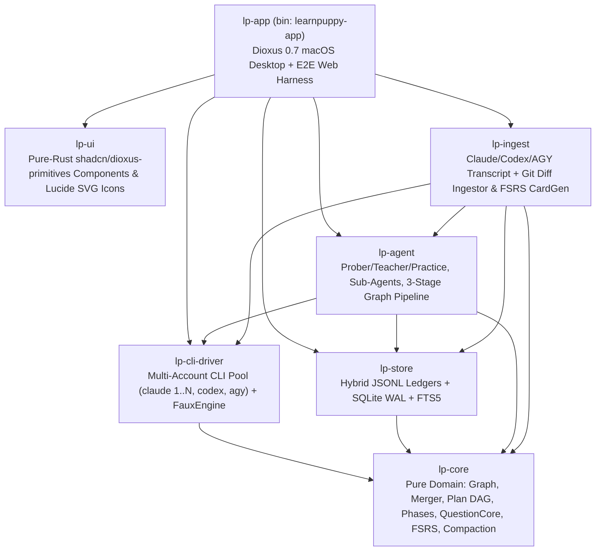
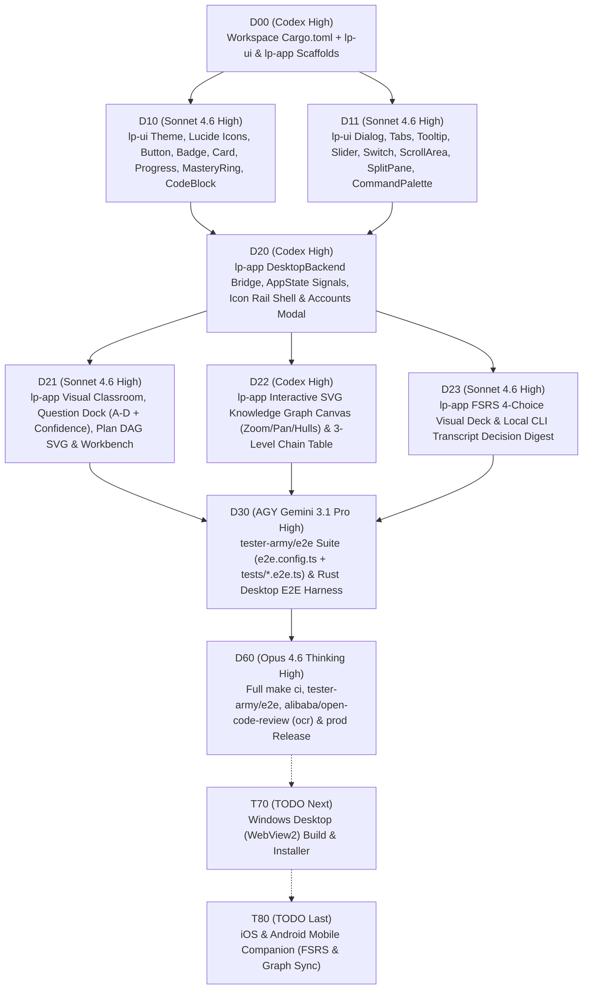

# LearnPuppy (`learnpuppy`) — Master Architecture & Multi-Worktree Execution Plan (Dioxus 0.7 + `lp-ui` Visual Desktop)

**Project Path**: `/Users/pratham/code/learnpuppy`  
**Isolated Legacy TUI/CLI Branch**: `legacy/tui-cli` (preserves the complete 6-crate Ratatui CLI/TUI build)  
**Target Platform Rollout Order**:
1. **macOS Native Desktop (`aarch64-apple-darwin` via Dioxus 0.7 `WKWebView`)** — **Active Deliverable (`Phase D`)**
2. **Windows Native Desktop (`x86_64-pc-windows-msvc` via WebView2)** — **Next (`TODO: T70`)**
3. **iOS & Android Mobile Companion (`dioxus` `mobile` + LAN/file FSRS & Graph sync)** — **Last (`TODO: T80`)**

**Reference Codebases & Installed Tooling**:
- [`amosblomqvist/learnharness`](https://github.com/amosblomqvist/learnharness.git) (Reverse-engineered via [`morluto/rea`](https://github.com/morluto/rea) in [`docs/REVERSE_ENGINEERING.md`](./REVERSE_ENGINEERING.md))
- `/Users/pratham/code/tracker` (Local CLI session ingestion, decision distillation, FSRS v5 spaced-repetition digest)
- [`DioxusLabs/components`](https://github.com/DioxusLabs/components) (`/tmp/dioxus-components`) & [`rust-ui/dioxus-ui`](https://github.com/rust-ui/dioxus-ui) (`/tmp/rust-ui-dioxus`) — audited for our pure-Rust `lp-ui` component crate
- [`humanlayer/skills`](https://github.com/humanlayer/skills) (`/tmp/humanlayer-skills`) — installed in `.claude/skills/` and `.agents/skills/` (`rpi`, `show-me`, `visual-pr`, `improve-claude-md`, `build-iterated-agentic-loop`, `design-control-loop`)
- [`tester-army/e2e`](https://github.com/tester-army/e2e) (`/tmp/tester-army-e2e`) & [`alibaba/open-code-review`](https://github.com/alibaba/open-code-review) (`ocr`) — E2E verification and automated line-level code review

---

## 0. Executive Summary: Why We Pivoted the UI to Dioxus 0.7 + `lp-ui`

Visual learning requires **spatial memory, clickable icons, an interactive zoomable Knowledge Graph canvas, visual Mermaid/DAG mastery rings, and instant mouse + keyboard ergonomics**. A terminal-only view (`ratatui`) sacrifices quick icons and visual hierarchy.

To keep **100% Rust** as the centerpiece of this portfolio project while delivering a flagship native desktop UI:
1. **Legacy CLI/TUI Preserved in Isolation**: The completed 28k-line Ratatui TUI + CLI implementation is frozen on git branch `legacy/tui-cli`.
2. **Zero Backend Rewrite**: All five core Rust crates (`lp-core`, `lp-store`, `lp-cli-driver`, `lp-agent`, `lp-ingest`) remain 100% intact and power the desktop app directly in-process with zero Electron/Node.js overhead.
3. **`crates/lp-ui` — Our Own Pure-Rust `shadcn/ui` + `dioxus-primitives` Component Engine**:
   - We cloned and audited both `DioxusLabs/components` (`dioxus-primitives`) and `rust-ui/dioxus-ui`.
   - **Critical Finding**: `rust-ui/dioxus-ui` has great OKLCH Tailwind dark-mode tokens (`tailwind.css`), **but** its interactive components (`Dialog`, `DropdownMenu`, `Sheet`, etc.) inject raw `<script>` tags with `setTimeout(setupDialog, 50)` DOM polling and depend on `wasm-bindgen`/`web-sys`/`gloo-timers`, which **do not compile on native macOS desktop (`aarch64-apple-darwin`)** and break when Dioxus re-renders!
   - **Our Solution (`lp-ui`)**: We combine `dioxus-primitives`'s pure-Rust `Signal<T>` / `Memo<T>` / ARIA state patterns with `rust-ui/dioxus-ui`'s OKLCH dark-mode design tokens and Lucide SVG icons in a 100% pure-Rust, desktop-native crate (`crates/lp-ui`).
4. **`crates/lp-app` — Native macOS Visual Learning App (`learnpuppy-app`)**:
   - Launches a native macOS `WKWebView` window (`dioxus::desktop`) with a sleek dark-mode icon rail, an interactive `<svg>` Knowledge Graph Canvas (smooth wheel zoom, drag pan, cubic-bezier edges, birth-session cluster hulls, clickable node provenance drawer), a split-screen Visual Classroom (Mermaid Plan DAG viewport, interactive Question Dock with `1..5` confidence slider), and a visual FSRS 4-Choice Flashcard & CLI Decision Digest deck.
   - Includes a dual-mode `--e2e-port` (`LP_E2E_PORT`) local web harness so `tester-army/e2e` (`@e2e-dev/web` + Playwright + AI agent steps) can test every visual screen end-to-end.

---

## 1. Eight-Crate Hexagonal Workspace Architecture

```
learnpuppy/
├── Cargo.toml                  # 8-crate workspace root, shared dependencies, strict clippy lints
├── CLAUDE.md                   # Rewritten with humanlayer `improve-claude-md` `<important if>` blocks
├── AGENTS.md                   # Pointer for Codex / AGY workers
├── Makefile                    # Gate runner: fmt, clippy, test, deny, okf, e2e, ocr
├── e2e.config.ts               # tester-army/e2e configuration driving learnpuppy-app
├── tests/                      # tester-army/e2e visual + agentic E2E specs (*.e2e.ts)
├── .claude/skills/             # Installed humanlayer + e2e + project skills (mirrored in .agents/skills/)
├── docs/
│   ├── PLAN.md                 # This master plan
│   └── REVERSE_ENGINEERING.md  # Clean-room REA + source spec of learnharness & tracker
├── brain/                      # OKF v0.1 knowledge bundle (26 files, validated with --strict)
└── crates/
    ├── lp-core/                # Pure synchronous domain core (0 IO, 0 async)
    ├── lp-store/               # Hybrid append-only JSONL ledgers + SQLite WAL + FTS5
    ├── lp-cli-driver/          # Multi-account CLI auth discovery (claude 1..N, codex, agy) + FauxEngine
    ├── lp-agent/               # Prober/Teacher/Practice loops, Sub-Agents, 3-Stage Graph Extractor/Auditor/Merger
    ├── lp-ingest/              # Claude/Codex/AGY transcript + Git commit ingestor & FSRS card generator
    ├── lp-ui/                  # NEW: Pure-Rust shadcn/Radix-style Dioxus 0.7 component & icon library
    ├── lp-app/                 # NEW: Native macOS Dioxus 0.7 visual desktop app (`learnpuppy-app`)
    └── lp-tui/                 # Headless CLI subcommands + legacy TUI (isolated on `legacy/tui-cli`)
```



---

## 2. In-Depth Dioxus 0.7 & `lp-ui` Guide: How To Use It vs What To Avoid Completely

Every worker touching `crates/lp-ui` or `crates/lp-app` MUST follow these rules (also codified in `.claude/skills/dioxus-desktop-ui/SKILL.md` and `brain/architecture/dioxus-ui.md`):

### 2.1 How To Use Dioxus 0.7 Properly
1. **Pure-Rust Reactivity (`Signal<T>`, `Memo<T>`, `use_context`)**:
   - Store localized UI state in `use_signal(|| ...)` and derived views (such as filtered graph nodes or derived `PlanTree` node statuses) in `use_memo(move || ...)`.
   - Provide the shared application state (`AppState` + `Arc<DesktopBackend>`) at the root `App` component via `use_context_provider`.
2. **Typed Props & Attribute Forwarding (`#[derive(Props, Clone, PartialEq)]`)**:
   - Use strongly-typed enums for variants and sizes (`ButtonVariant`, `ButtonSize`, `BadgeVariant`) with `#[props(default)]`.
   - Use `#[props(into, optional)] class: Option<String>` and a pure-Rust `cn(&[base, variant, custom])` class joiner to merge utility classes cleanly.
3. **Non-Blocking Desktop Async (`spawn` + `tokio::task::spawn_blocking`)**:
   - Dioxus's `VirtualDom` runs on the main OS thread (`!Send`).
   - Run streaming `LlmEngine` turns inside `spawn(async move { ... })`, updating `Signal`s as deltas arrive.
   - Wrap synchronous SQLite (`rusqlite`) or filesystem (`std::fs`) calls in `tokio::task::spawn_blocking` so the macOS `WKWebView` stays locked at 60fps.
4. **Hardware-Accelerated `<svg>` Canvas for the Knowledge Graph & Plan DAG**:
   - Render the Knowledge Graph (`GraphSnapshot`) and `PlanTree` DAG as native Dioxus `svg { view_box: ..., onwheel: ..., onmousedown: ..., onmousemove: ..., onmouseup: ... }` elements.
   - Compute 2D coordinates in Rust (`lp-core::graph::settle_positions` for the Knowledge Graph; layered Sugiyama/topological rank layout for the `PlanTree` DAG) and draw cubic-bezier edges (`<path d="M ... C ..."/>`), cluster convex hulls, glowing mastery rings, and clickable `<g>` node groups.
5. **Accessibility & E2E Testability (`data-testid` + ARIA)**:
   - Every interactive control in `lp-ui` and `lp-app` must emit semantic HTML roles (`role="dialog"`, `role="tab"`, `role="status"`, `aria-selected`, `aria-label`) and deterministic `data-testid="..."` attributes so `tester-army/e2e` locators and AI agents can inspect the screen with zero ambiguity.

### 2.2 Things To Avoid Completely (Hard Bans)
1. **NEVER use `script { dangerous_inner_html: "..." }` or `setTimeout` DOM polling**:
   - `rust-ui/dioxus-ui` uses inline `<script>` tags that poll `document.querySelector` every 50ms to wire up dialogs and dropdowns. This is a severe anti-pattern in Dioxus: when a signal triggers a VirtualDOM patch, raw JS listeners desync or leak. All open/close/tab/selection state MUST live in Rust `Signal`s.
2. **NEVER import `wasm_bindgen`, `web_sys`, `js_sys`, or `gloo_timers`**:
   - Those crates target `wasm32-unknown-unknown` and **fail to compile** on native macOS desktop (`aarch64-apple-darwin`).
3. **NEVER omit `evt.prevent_default()` on `<form onsubmit>`**:
   - In Dioxus 0.7 desktop (`wry`), an un-prevented form submission triggers a browser page reload that resets the entire Rust `VirtualDom`.
4. **NEVER allow root window scrollbars**:
   - Always style the root container with `h-screen w-screen overflow-hidden select-none flex bg-background text-foreground` and restrict scrolling to internal `ScrollArea` panes (`overflow-y-auto`).
5. **NEVER mutate a `Signal` inside the body of a component render function or `use_memo`**:
   - Mutating signals during render causes infinite re-render loops. Only mutate signals inside event handlers (`onclick`, `oninput`, etc.), `use_effect`, or `spawn` futures.

---

## 3. Exact Model Selection & Effort Matrix (`claude`, `codex`, `agy`)

We leverage the distinct strengths of all three CLI ecosystems installed on this machine:

| Role & Domain | CLI Tool | Exact Model Name | Effort Level | Exact Invocation Pattern | Why It Excels Here |
|---|---|---|---|---|---|
| **Chief Orchestrator, Planner & Final Auditor** | `agy` (or `claude`) | `claude-opus-4-6-thinking` (`opus`) | `high` (`max` on `D60`) | `agy --model claude-opus-4-6-thinking --effort high --dangerously-skip-permissions --mode auto -p "..."` | Unmatched at cross-crate architecture, catching subtle state/concurrency bugs, and auditing full spec parity. |
| **Rust Systems, Cargo & SVG Geometry Specialist** | `codex` | `gpt-5.4` / `gpt-6-luna` | `high` | `codex exec --dangerously-bypass-approvals-and-sandbox -c model_reasoning_effort="high" -C <wt> "..."` | Best at Cargo dependency resolution (`D00`), async backend bridging (`D20`), and deterministic 2D SVG graph/bezier math (`D22`). |
| **Dioxus 0.7 Component & Visual Screen Specialist** | `agy` (or `claude`) | `claude-sonnet-4-6` (`sonnet`) | `high` | `agy --model claude-sonnet-4-6 --effort high --dangerously-skip-permissions --mode auto -p "..."` | Best at crafting polished `shadcn/ui` CSS/OKLCH themes, Lucide SVG icons, `lp-ui` primitives (`D10`, `D11`), Classroom UI (`D21`), and FSRS/Digest UI (`D23`). |
| **E2E (`tester-army/e2e`) & Code Review (`ocr`) Runner** | `agy` | `gemini-3.1-pro-high` | `high` | `agy --model gemini-3.1-pro-high --effort high --dangerously-skip-permissions --mode auto -p "..."` | Fast, reliable harness wiring for `tester-army/e2e`, Playwright/SSR assertions (`D30`), and `alibaba/open-code-review` (`ocr`) remediation (`D60`). |

---

## 4. Phase D Multi-Worktree Task DAG (`D00` – `D60`, plus `T70` & `T80` Roadmap)



### Wave 1 — Workspace & `lp-ui` / `lp-app` Disjoint Scaffolds (`D00`)
- **`D00` (`codex` `gpt-5.4` / `gpt-6-luna` `high`)**:
  - **Scope**: Add `crates/lp-ui` and `crates/lp-app` to root `Cargo.toml` with `dioxus = { version = "0.7", features = ["desktop"] }` and `dioxus-ssr = "0.7"`. Pre-declare disjoint module files in `crates/lp-ui/src/` (`lib.rs`, `theme.rs`, `icons.rs`, `primitives.rs`, `code_block.rs`, `dialog.rs`, `tabs.rs`, `overlays.rs`, `command_palette.rs`) and `crates/lp-app/src/` (`main.rs`, `lib.rs`, `state.rs`, `backend.rs`, `shell.rs`, `views/mod.rs`, `views/classroom.rs`, `views/graph_canvas.rs`, `views/digest_fsrs.rs`, `views/accounts.rs`) so Wave 2 and Wave 4 workers can run in parallel on separate git worktrees with **zero merge conflicts**.
  - **Gate**: `make gate` passes on `staging`.

### Wave 2 — Parallel `lp-ui` Component Library Build (`D10` || `D11`)
- **`D10` (`agy` `claude-sonnet-4-6` `high`) — `lp-ui` Theme, Icons & Core Visual Components**:
  - **Disjoint Files**: `crates/lp-ui/src/{theme.rs, icons.rs, primitives.rs, code_block.rs}`.
  - **Scope**:
    - `theme.rs`: Complete OKLCH dark-mode stylesheet (`LP_THEME_CSS`) with shadcn variables, utility classes, mastery ring colors, custom thin scrollbars, and shimmer animations.
    - `icons.rs`: 20+ pure-Rust Lucide SVG icon components (`IconGraph`, `IconClassroom`, `IconDigest`, `IconSparkles`, `IconCheck`, `IconX`, `IconChevronRight`, `IconChevronDown`, `IconSearch`, `IconSettings`, `IconTerminal`, `IconBook`, `IconBrain`, `IconRefresh`, `IconPlay`, `IconShield`, `IconPlus`, `IconTrash`, `IconZoomIn`, `IconZoomOut`, `IconMaximize`).
    - `primitives.rs`: `Button` (`Primary`, `Secondary`, `Outline`, `Ghost`, `Destructive`, `Link`; sizes `Xs..Lg`, `Icon`), `Badge`, `Card` (`CardHeader`, `CardTitle`, `CardDescription`, `CardContent`, `CardFooter`), `Separator`, `Progress`, and SVG `MasteryRing` (0..100% circular ring).
    - `code_block.rs`: Markdown + `syntect` syntax-highlighted block renderer with language header and copy button.
  - **Tests**: `dioxus-ssr` unit tests verifying rendered HTML, classes, ARIA attributes, and SVG paths for every component.
- **`D11` (`agy` `claude-sonnet-4-6` `high`) — `lp-ui` Interactive Primitives & Overlays (Zero Inline-JS)**:
  - **Disjoint Files**: `crates/lp-ui/src/{dialog.rs, tabs.rs, overlays.rs, command_palette.rs}`.
  - **Scope**:
    - `dialog.rs`: Pure-Rust controlled/uncontrolled `Dialog`, `DialogHeader`, `DialogTitle`, `DialogDescription`, `DialogContent`, `DialogFooter` with `role="dialog"`, `aria-modal="true"`, backdrop dismiss, and `Escape` key handler.
    - `tabs.rs`: Context-driven `Tabs`, `TabsList`, `TabsTrigger`, `TabsContent` (`role="tablist"`, `role="tab"`, `aria-selected`).
    - `overlays.rs`: `Tooltip`, `Slider` (1..5 confidence & numeric parameter slider), `Switch`, `Checkbox`, `ScrollArea`, and `SplitPane`.
    - `command_palette.rs`: `CommandPalette` (`Cmd+K` / `Ctrl+K` modal with live fuzzy filtering, keyboard up/down selection, and shortcut badges).
  - **Tests**: `dioxus-ssr` unit tests verifying open/closed states, active tab switching, slider value rendering, and command filtering.

### Wave 3 — `lp-app` Desktop Backend Bridge, Shell & Accounts Modal (`D20`)
- **`D20` (`codex` `gpt-5.4` `high`)**:
  - **Disjoint Files**: `crates/lp-app/src/{main.rs, lib.rs, state.rs, backend.rs, shell.rs, views/accounts.rs}`.
  - **Scope**:
    - `backend.rs`: `DesktopBackend` connecting `FsChatStore`, `FsGraphStore`, `FsJobStore`, `SqliteTrackerStore`, `AccountPool` (multi-account Claude + Codex + AGY), `ProberAgent`, `TeacherAgent`, `PracticeAgent`, `Extractor/Auditor/Merger`, and `lp-ingest` into clean async methods callable from Dioxus signals/tasks, plus automatic demo/tracker seeding when opened on a fresh store so the visual Graph and FSRS deck are immediately populated.
    - `shell.rs`: Native macOS desktop window shell (`h-screen w-screen overflow-hidden flex`), Left Quick-Action Icon Rail (`Graph Home`, `Classroom`, `FSRS & Digest`, `CLI Accounts`), Top Status Bar (active CLI account pill, graph node/chain counters, `Cmd+K` search trigger, quick "New Topic" & "Sync CLI History" buttons), and `CommandPalette` integration.
    - `views/accounts.rs`: Visual Multi-Account CLI & Role Slots dashboard showing discovered Claude accounts (`claude #1: pratham.bhavsar501@gmail.com`, `claude #2: q97159745@gmail.com`), Codex (`yadavkumar49900@gmail.com`), and AGY with health badges, cooldown timers, and per-role model/effort selectors.
    - `main.rs`: Supports both `dioxus::LaunchBuilder::desktop()` (native macOS window with custom titlebar/size 1440x900) and `LP_E2E_PORT=<port>` / `--e2e-port <port>` local HTTP/SSR+liveview harness for `tester-army/e2e` and `--check-render` smoke verification.

### Wave 4 — Parallel Visual Screens (`D21` || `D22` || `D23`)
- **`D21` (`agy` `claude-sonnet-4-6` `high`) — Visual Classroom, Question Dock & Plan DAG Split View**:
  - **Disjoint File**: `crates/lp-app/src/views/classroom.rs`.
  - **Scope**:
    - Collapsible Left Session Drawer (`Teaching | Practice | All`, phase badges `PROBE`/`PLAN`/`TEACH`/`PRACTICE`, New Session input, and live Sub-Agent Workbench cards for `researcher`, `pdf-reader`, `visual-maker`, `demo-builder`).
    - Center Visual Lesson Stream: Renders teacher/prober turns with `lp-ui::CodeBlock`, tables, callouts, and graded answer verdict banners.
    - Bottom Interactive Question Dock: Clickable `[A]..[D]` option cards with keyboard shortcut pills, `[I] I don't know` button, interactive `1..5` Confidence Slider (`1=Guess .. 5=Certain`), dual `Reading Notes` and `Answer Reasoning` tabs, and `R0..R5` Practice Hint button.
    - Right Visual Plan DAG Viewport: Interactive `<svg>` dependency graph of the session's `PlanTree` showing topological levels, directed edges, and glowing status rings (`● Current`, `✓ Visited`, `○ Upcoming`).
- **`D22` (`codex` `gpt-5.4` `high`) — Interactive SVG Knowledge Graph Canvas & 3-Level Chain Table**:
  - **Disjoint File**: `crates/lp-app/src/views/graph_canvas.rs`.
  - **Scope**:
    - Sub-mode 1 (`Canvas View` — Default Home Screen): Hardware-accelerated `<svg>` viewport rendering propositions (`n_...`), implication junctions (`arg_...`), directed cubic-bezier arrows, and translucent birth-session cluster hulls. Includes floating toolbar (`Zoom In`, `Zoom Out`, `Fit View`, `Search Filter`, `Practice Selected (N)`), mouse wheel zoom, drag pan, and right-side **Node Provenance & Aliases Drawer** on node click.
    - Sub-mode 2 (`Chain Table View`): Collapsible 3-level visual table (`Cluster -> Premise A ∧ Premise B ⟹ Conclusion C -> Precision Statements & Provenance`) with checkbox selection to launch an Adaptive Practice Session or preview deletion blast radius.
- **`D23` (`agy` `claude-sonnet-4-6` `high`) — FSRS 4-Choice Visual Deck & CLI Transcript Digest**:
  - **Disjoint File**: `crates/lp-app/src/views/digest_fsrs.rs`.
  - **Scope**:
    - Sub-tab 1 (`FSRS Spaced-Repetition Deck`): Visual flashcard studio with `MasteryRing` progress, category badges (`why`, `predict`, `bug`, `trace`, `ownership`, `cloze`), clickable 4-option cards, instant rationale + source commit reveal, and 1-click FSRS v5 grading buttons (`[1] Again`, `[2] Hard`, `[3] Good`, `[4] Easy`) showing next scheduled interval.
    - Sub-tab 2 (`Local CLI Coding Digest`): Visual cards for ingested `claude` (all accounts), `codex`, and `agy` coding sessions and Git commits across `/Users/pratham/code/tracker` and `/Users/pratham/code/bunfiiliate`, displaying distilled `DecisionRecord`s (`What`, `Why`, `Basis`, `Alternatives Rejected`, `Risk`) with 1-click **"Fold into Knowledge Graph"** and **"Scan Local CLIs Now"** actions.

### Wave 5 — `tester-army/e2e` & Desktop Verification Suite (`D30`)
- **`D30` (`agy` `gemini-3.1-pro-high` `high`)**:
  - **Disjoint Files**: `e2e.config.ts`, `package.json`, `tests/*.e2e.ts`, `crates/lp-app/tests/e2e_desktop.rs`.
  - **Scope**:
    1. Configure `e2e.config.ts` (`tester-army/e2e` with `@e2e-dev/web`) pointing at `learnpuppy-app --e2e-port {port}` and author comprehensive E2E test specs (`tests/graph-home.e2e.ts`, `tests/classroom-flow.e2e.ts`, `tests/fsrs-digest.e2e.ts`, `tests/cli-accounts.e2e.ts`) combining deterministic `screen.getByTestId` / `getByRole` assertions with `agent.act` / `agent.assert` steps.
    2. Author Rust integration suite `crates/lp-app/tests/e2e_desktop.rs` testing full desktop state transitions, multi-account CLI pool discovery, Classroom quiz grading, Graph SVG rendering, and FSRS card scheduling.

### Wave 6 — Final CI, `alibaba/open-code-review` (`ocr`), Opus Sign-Off & `prod` Release (`D60`)
- **`D60` (`agy` `claude-opus-4-6-thinking` `high`)**:
  - **Scope**:
    1. Run full `make ci` (`cargo fmt --check`, `cargo clippy --workspace --all-targets -- -D warnings`, `cargo test --workspace --all-targets`, `cargo deny check`, `validate.py brain --strict`).
    2. Execute E2E verification suite (`cargo test -p lp-app --test e2e_desktop` + `tester-army/e2e`).
    3. Run `alibaba/open-code-review` (`ocr scan` / `ocr review`) across `crates/lp-ui` and `crates/lp-app` and fix any flagged issues.
    4. Perform final Opus architectural sign-off and fast-forward `prod` to `staging`.

---

## 5. Future Cross-Platform Phases (`TODO` — Scheduled After macOS Release)

- **`T70` — Phase W (Next): Windows Desktop (`x86_64-pc-windows-msvc` / WebView2)**:
  - Normalize CLI discovery paths for Windows (`%USERPROFILE%\.claude`, `%APPDATA%\codex`, `%USERPROFILE%\.gemini`), verify Dioxus 0.7 WebView2 window chrome, and add Windows `.msi`/`.exe` bundler config.
- **`T80` — Phase M (Last): iOS & Android Mobile Companion (`dioxus` `mobile`)**:
  - Enable `dioxus = { version = "0.7", features = ["mobile"] }`, add touch pinch-to-zoom on the SVG Graph Canvas, and wire LAN/file sync (`sync-<device>.jsonl` + `nodes.jsonl` + `chains.jsonl`) so mobile devices act as a companion FSRS flashcard reviewer and Knowledge Graph explorer.
