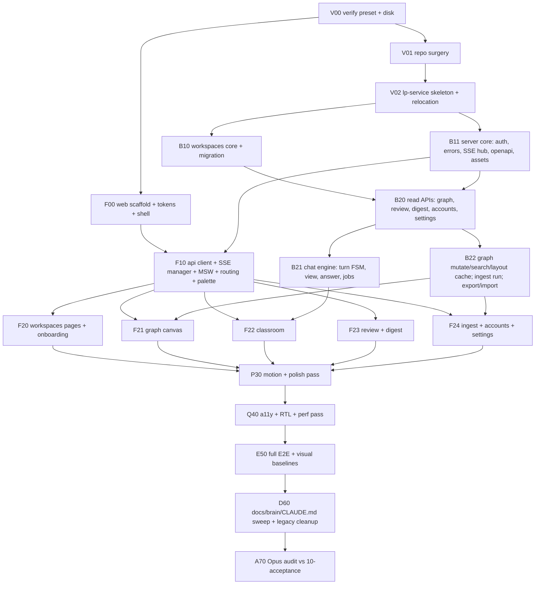

# 08 — Task DAG (waves, ownership, done-when)

Process: follow existing rules — coordinator (Opus) orchestrates, workers code in worktrees `pratham404/<task-id>`, merge `--no-ff` into `staging`, `make gate` before every merge, **never touch `prod` without asking**. File ownership per task is disjoint inside a wave. Routing suggestion: Rust backend → Codex (gpt-5.x high); React/CSS/motion → Sonnet (high); E2E + review → Gemini/Claude; final audit → Opus. (Adjust to `orca-model-matrix` skill at dispatch time.)

## Wave 0 — Ground truth (sequential, small)
| ID | Work | Files | Done when |
|---|---|---|---|
| V00 | In scratchpad run the exact shadcn init; write `docs/web/04-preset-facts.md` (components.json, fonts, icon lib, radix vs lyra delta, `--rtl`/`--pointer` effect). Check free disk ≥ 6 GB or free space (`cargo clean`, caches) | docs only | facts doc exists; any surprise listed as decision; disk plan written |
| V01 | Branch `pratham404/V01`: remove `lp-ui lp-app lp-tui` from workspace `members`, delete crates, delete Dioxus-specific `tests/`, `e2e.config.ts`, root e2e deps; keep `legacy/tui-cli` untouched; remove `scripts/export-icons.ts`; `cargo clean` | `Cargo.toml`, `crates/*`, `tests/`, root configs | `cargo check --workspace` green with 5 crates; `make okf` still passes (brain updated minimally) |
| V02 | Create `lp-service` + `lp-server` skeleton; relocate from deleted `lp-tui`: engine, settings, session helpers, review (copy from git history `git show <sha>:path`); verify store constructors take a root path (fix hardcoded `~/.learnpuppy` if any); unit tests ported | `crates/lp-service/**`, `crates/lp-server/**`, root `Cargo.toml` | `cargo test -p lp-service` green, ported tests pass, `learnpuppy --version` runs |

## Wave 1 (parallel)
| ID | Work | Files | Done when |
|---|---|---|---|
| B10 | Workspace registry/meta/lifecycle/trash/migration/export-import per 02, with golden-fixture + kill-midway tests | `lp-service/src/workspace/**` | all 02 operations tested; migration of a copy of real `~/.learnpuppy` verified (counts equal before/after); `migrate --revert` works |
| B11 | Server core: app/router, auth+Host/Origin/CSRF, error envelope, request ids, SSE hub with ring buffer/replay/resync/heartbeat, utoipa wiring + `openapi` subcommand, rust-embed assets with SPA fallback + CSP, lock file/port selection, graceful shutdown, `/health`, `/bootstrap` | `lp-server/src/{main,cli,app,auth,error,sse,openapi,assets}.rs`, `lp-service/src/events.rs` | 03 auth/SSE test lists green; `openapi.json` generated |
| F00 | `web/` init (04), `scripts/hex2oklch.ts` + tokens (light/dark) + contrast script, fonts, theme switch, shell (sidebar/topbar/switcher static), `/gallery` route showing every shadcn component used in light/dark/RTL, motion lib + CountUp/Skeleton, lint rules, Vitest+Playwright harness | `web/**` (except features) | `bun run check` green; gallery screenshot light/dark/RTL committed; palette diff vs preset = colors only |

## Wave 2
| ID | Work | Files | Done when |
|---|---|---|---|
| B20 | Read/simple endpoints: workspaces CRUD routes, graph snapshot (+ETag, positions cache), node detail, search, chats list/view (no turns yet), review queue/answer/grade/stats/preview/browse, digest, accounts/settings/catalog, global search, trash | `lp-server/src/routes/*`, `lp-server/src/dto/*`, `lp-service/src/{graph,review,digest,accounts,settings}.rs` | each endpoint has oneshot tests; DTO has no leaking correct-answer; openapi regenerated; `seed` command produces fixtures |
| F10 | `api/` client + generated types + MSW handlers/fixtures, SSE manager, query keys, route tree, error boundaries, ConnectionBanner, CommandPalette + registry, hotkey system, shortcuts sheet, toasts | `web/src/{api,routes,lib,hooks,stores}`, `features/{palette,shell}` | component tests for SSE reconnect/resync (fake EventSource), palette keyboard test, routes typed |

## Wave 3 (parallel features)
| ID | Work | Files | Done when |
|---|---|---|---|
| B21 | Chat engine: create chat, turn POST/cancel, per-chat mutex, run_to_rest in task, delta coalescing → SSE, `ClassroomView` build, answer validation/stale handling, steers, jobs (workbench launch/abort/recover), PDF upload, artifact serving (sandbox CSP), semaphore/queued state, restart recovery | `lp-service/src/chat/**`, `lp-server/src/routes/{chats,artifacts}.rs` | 03 turn tests green incl. full Probe→Plan→Teach with Faux; cancel; restart-mid-turn |
| B22 | Graph delete preview/apply, relayout (spawn_blocking, cached positions + version), practice-from-selection, ingest run/progress/history/sources detect, export/import jobs + downloads | `lp-service/src/{graph,ingest,workspace/export}.rs`, routes | tests; ingest on fixture transcripts; export→import roundtrip equality |
| F20 | Home, onboarding, workspace dialogs/menu, switcher wiring, trash, archived, damaged states | `features/workspaces` | E2E: create/rename/archive/delete/restore/export/import |
| F21 | Graph canvas (renderer, camera, hit-test, tweens, LOD, hulls, minimap), NodeDrawer, ChainTable, SelectionBar, filters/search, GraphList a11y, perf mode | `features/graph` | 5k-node fixture meets budget; keyboard nav; all 23 graph-related animations present |
| F22 | Classroom: list, composer, messages, streaming text, QuestionDock ×6, ConfidenceSlider, PlanDag, stepper, jobs/artifacts, queue/error states | `features/classroom` | Faux full-session E2E: probe→plan→teach, quiz reveal, problem, cancel, retry |
| F23 | Review (session, summary, stats, forecast, browser) + Digest (groups, drawer, regenerate) + review-all | `features/{review,digest}` | E2E: grade flow keyboard-only; optimistic rollback test |
| F24 | Ingest, Accounts (+role slots, test ping), Settings (global+ws), Diagnostics | `features/{ingest,accounts,settings}` | E2E per screen; overlap warning; cooldown countdown |

## Wave 4 — Quality
| ID | Work | Done when |
|---|---|---|
| P30 | Motion + polish pass over 05 catalogue: implement/verify all 45 items, reduced-motion path, empty/error illustrations-free states, copy pass, spacing audit vs preset | each catalogue item ticked in `docs/web/10-acceptance.md`; reduced-motion test green |
| Q40 | a11y (axe zero serious), keyboard-only walkthrough of all journeys, RTL pass (mirroring bugs), perf traces and fixes, bundle budget, memory leak run | all budgets in 07 pass |
| E50 | Complete Playwright suites (journeys, visual light/dark/LTR/RTL, auth/security, offline/reconnect), flake hunt (3 consecutive green runs ×2 browsers) | `make e2e` green 3× |
| D60 | Update `CLAUDE.md`, `AGENTS.md`, `Makefile`, `brain/` (ADR 0006 web-over-dioxus superseding 0005, `architecture/web-ui.md`, `server-api.md`, task index), root `README`, `docs/PLAN.md` header note, delete `DESIGN_SYSTEM_PLAN.md`→ archived pointer; `make okf` strict green | gate green |
| A70 | Opus read-only audit against `10-acceptance.md` + security checklist + "no domain logic in TS" grep + real-engine smoke run; report only | signed checklist; punch list = zero P0/P1 |

## Branch/merge notes
- One worktree per task id; waves merge in dependency order. Frontend tasks depend on generated `openapi.json` + MSW fixtures, so F-tasks never wait on running B-tasks: they build against MSW until backend lands, then flip `VITE_API=real` in E2E.
- Disjoint file rule: shared files (`router`, `palette registry`, `openapi.json`, `keys.ts`) are touched only by their owner task; others add via registry/contribution files (`features/*/contrib.ts`).
- Conflict hotspot to watch: `lp-server/src/routes/mod.rs` and `dto/mod.rs` (each route file self-registers via a macro or `routes()` fn; only B11 edits `app.rs`).
